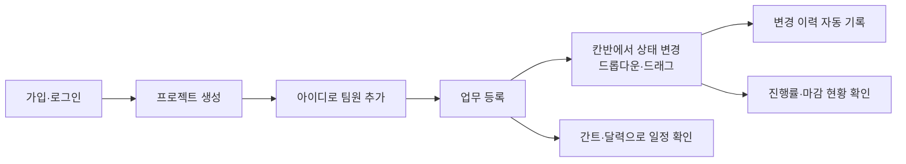

# 동잇 한눈에 보기 (PROJECT-OVERVIEW.md)

> 버전: v1.2 (2026-11-26 배포 주소 추가) · v1.1 (2026-11-25 최종 구현 범위 반영) · v1.0 (2026-11-16 스펙 동결: 일정·팀 분담 회의 결정 반영) | 작성일: 2026-11-11 · 수정일: 2026-11-26
> 처음 보는 사람을 위한 1페이지 소개. 상세는 맨 아래 "문서 지도"의 원본 문서를 본다. 내용이 다르면 원본을 따른다(기획서 → 헌법 → 요구사항 순).

## 한 줄 소개

팀이 프로젝트 단위로 업무를 등록하고 담당자·마감일·우선순위를 정해 **칸반 보드로 진행 상황을 관리하고, 변경 이력과 마감 위험을 한눈에 보는** 웹 서비스.

## 왜 만드나

| 문제 | 동잇의 해결 |
| --- | --- |
| 업무가 메신저·메모에 흩어져 빠진다 | 업무 등록(담당자·마감일·우선순위) + 칸반 보드 |
| 회의를 해야 진행 상황을 안다 | 프로젝트 진행률, 최근 활동 20건 |
| 마감이 지나서야 지연을 안다 | **마감 임박(오늘~3일)·지연 대시보드** ★ |
| 누가 언제 마감일을 바꿨는지 모른다 | **업무 변경 이력 자동 기록** ★ |

★ 차별화 기능

## 누가 쓰나

| 사용자 | 역할 | 하는 일 |
| --- | --- | --- |
| 팀장 | OWNER | 프로젝트 생성, 팀원 추가, 업무 분배, 마감 관리 |
| 팀원 | MEMBER | 내 업무 확인, 상태 변경, 업무 등록 |
| 관리자 | ADMIN | 계정 관리 (P2) |

## 이렇게 쓴다



## 무엇을 만드나 (MoSCoW)

| 단계 | 기능 | 결과 |
| --- | --- | --- |
| **Must (P0 = MVP)** | 회원가입·로그인, 프로젝트 CRUD, 멤버 추가·제거, 업무 CRUD, 버튼식 칸반, 변경 이력 기록 | ✅ 전부 (11/19 게이트 통과) |
| **Should (P1)** | 진행률, 검색·필터, 댓글, 이력 조회, 마감 임박·지연, 내 대시보드, 담당자별 현황, 내 정보 수정, 멤버 역할 변경 | ✅ 전부 (11/23) |
| **Could (P2)** | 드래그 앤 드롭, 달력, 간트 보기 | ✅ 기능 동결 예외 3개만 (11/24) |
|  | 체크리스트·업무 진행률, 비밀번호 변경, 탈퇴, 프로젝트 나가기, Refresh Token, 관리자 등 | 하지 않음 (향후 계획) |
| **Won't** | 실시간 알림, 이메일, 파일 첨부, 외부 연동, AI 기능, 보기 전용 역할 | 만들지 않음 |

전체 목록: [REQUIREMENTS.md §7](./REQUIREMENTS.md#7-우선순위moscow와-mvp-범위)

## 어떻게 만드나

| 영역 | 기술 |
| --- | --- |
| 화면 | React 19 · Vite · React Router · Tailwind CSS 4 · Axios (Node 22) |
| 서버 | FastAPI · Pydantic · Uvicorn (Python 3.12) |
| DB | MariaDB 10.11(Docker) · SQLAlchemy 2.x · Alembic · PyMySQL |
| 인증 | JWT Access Token(2시간, PyJWT) · bcrypt |
| 테스트 | pytest(P0 핵심 API) · Postman |
| 시연 | 로컬(Docker MariaDB + 시드 데이터) |
| 배포 | <https://doing-it.netlify.app> — 화면 Netlify · 서버·DB Railway (ARCHITECTURE §9.1) |

**개발 방식 SDD:** 명세 작성 → AI로 구현 → 사람이 검토 → 테스트 → 명세와 비교. 명세에 없는 기능·API·테이블은 만들지 않는다.

## 팀과 일정

| 이름 | 영역 |
| --- | --- |
| 양준석 (A조, 팀장) | 백엔드 — 인증, 프로젝트·멤버 API, 권한, 진행률·마감 현황·내 대시보드 API |
| 최진영 (A조) | 프론트엔드 — 공통 UI, 로그인·프로젝트 화면, 진행률·통계·내 대시보드 화면 |
| 서승범 (B조, 예비 팀장) | 백엔드 — DB, 업무·이력·검색·댓글 API, pytest |
| 김서현 (B조) | 프론트엔드 — 칸반, 업무 등록·상세, 검색·이력·댓글 화면 |

```
11/10 ─ 11/13      11/16 ─ 11/19 오전    11/19 오후 ─ 11/23   11/24      11/25 ─ 11/26
명세·설계·환경      P0 구현 (MVP)          P1 구현               검증·동결   마무리·발표
                                ▲ 11/19 P0 게이트                                ▲ 11/26 발표 · 11/24 기능 동결(M3)
```

## 문서 지도 — 무엇을 알고 싶으면 어디를 보나

| 알고 싶은 것 | 문서 |
| --- | --- |
| 왜·무엇을·언제 (기획 전체) | [PROPOSAL.md](./PROPOSAL.md) |
| 팀 규칙·원칙 | [CONSTITUTION.md](./CONSTITUTION.md) |
| 기능 ID·우선순위·권한 | [REQUIREMENTS.md](./REQUIREMENTS.md) |
| 기능별 동작(Given-When-Then) | [SPEC.md](./SPEC.md) |
| 사용자 스토리·수용 기준 | [USER-STORIES.md](./USER-STORIES.md) |
| 테이블 설계 | [DATABASE-DESIGN.md](./DATABASE-DESIGN.md) |
| API | [API-SPEC.md](./API-SPEC.md) |
| 화면 구성·표시 규칙 | [UI-DESIGN.md](./UI-DESIGN.md) |
| 폴더·계층·버전·실행 환경 | [ARCHITECTURE.md](./ARCHITECTURE.md) |
| 기능과 스토리 연결표 | [PRD.md](./PRD.md) |
