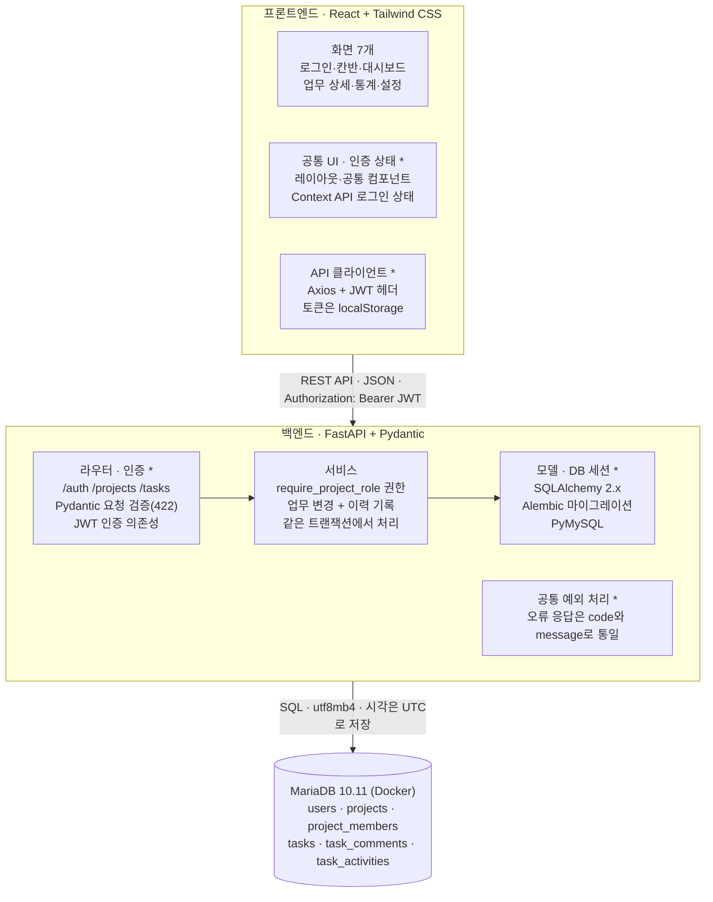
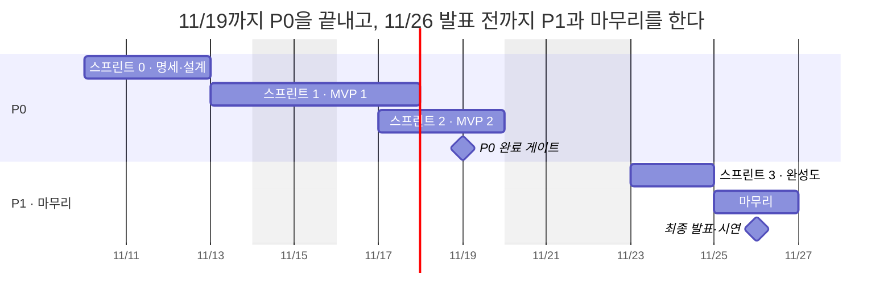

# 팀 협업 관리 시스템 기획서

2026-11-10 · 

## 1. 프로젝트 개요

본 프로젝트는 팀이 프로젝트 단위로 업무를 등록하고 담당자·마감일·우선순위를 지정하여 칸반 보드로 진행 상황을 관리하는 웹 서비스 동잇(Doing_It)를 개발합니다. 팀원 4명이 2026년 11월 10일부터 11월 26일까지 총 92시간 동안 SDD 방식으로 수행합니다.

| 항목 | 내용 |
| --- | --- |
| 프로젝트명 | 동잇(Doing_It) — 팀 협업 프로젝트 관리 시스템 |
| 수행 인원 | 4명 (백엔드 양준석·서승범, 프론트엔드 최진영·김서현) |
| 기간 | 2026-11-10 ~ 2026-11-26 (총 92시간, 평일 1일 8시간 기준, 11/20 휴무, 11/26 최종 발표) |
| 개발 방식 | SDD(Spec-Driven Development): 명세 작성 → AI로 구현 → 코드 검토 → 테스트 → 명세와 비교 |
| 결과물 | 웹 서비스, 명세 문서 5종(프로젝트 규칙, 요구사항 명세, 사용자 스토리, DB 설계, API 명세), 재사용 가능한 스타터킷 |

## 2. 배경과 문제 정의

소규모 팀의 업무는 메신저와 개인 메모에 흩어져 있어, 누가 무엇을 언제까지 하는지 한곳에서 보기 어렵습니다. 본 프로젝트는 다음 네 가지 문제의 해결을 목표로 합니다.

| 문제 | 현재 상황 | 해결 방안 |
| --- | --- | --- |
| 업무 누락 | 구두로 정한 업무가 기록되지 않아 누락된다 | 업무 등록(담당자·마감일·우선순위), 칸반 보드 |
| 진행 상황 불투명 | 회의를 거쳐야 진행 상황을 파악할 수 있다 | 프로젝트 진행률, 최근 활동 20건 |
| 마감 놓침 | 마감일이 지난 후에야 지연을 인지한다 | 마감 임박(3일 이내)·지연 업무 대시보드 |
| 변경 이유 불명 | 마감일·담당자 변경의 주체와 시점을 확인할 수 없다 | 업무 변경 이력(Activity Log) 자동 기록 |

아울러 본 프로젝트는 AI 코딩 도구를 활용하되, 명세를 먼저 작성하고 이에 맞추어 구현하는 SDD 방식을 팀 단위로 습득하는 것을 목적으로 합니다.

## 3. 목표와 성공 기준

목표는 "업무 누락을 줄이고, 팀원별 업무 현황과 프로젝트 진행률을 한눈에 파악한다"입니다. 아래 기준을 모두 충족하면 프로젝트를 성공으로 판단합니다.

| # | 성공 기준 | 확인 방법 |
| :-: | --- | --- |
| 1 | P0 기능(인증, 프로젝트·멤버 관리, 업무 CRUD, 칸반 보드, 변경 이력 기록)을 100% 구현 | 기능별 수용 기준 점검 |
| 2 | P0 핵심 API(인증·권한·업무 CRUD) pytest 전부 통과 | CI 또는 로컬 pytest 결과 |
| 3 | 권한 실패 케이스(비멤버 403, MEMBER의 타인 작성 업무 삭제 403 등)를 테스트로 보장 | pytest 실패 케이스 목록 |
| 4 | P1 기능 중 우선 5개(검색·필터, 댓글, 변경 이력 조회, 마감 임박·지연, 내 업무 대시보드) 구현 | 시연 시나리오 |
| 5 | `main` 직접 push 0건, 모든 PR이 리뷰 1명 승인과 린트 통과 후 병합 | GitHub PR 기록 |
| 6 | 명세와 구현이 일치(명세에 없는 API·테이블 0개) | 마무리 단계 명세-구현 비교표 |
| 7 | 데스크톱 브라우저에서 주요 화면 7개 동작 | 화면별 수동 점검 |
| 8 | 공통 모듈(인증, API 클라이언트, DB 세션, 예외 처리, 공통 UI)을 스타터킷으로 분리 | 별도 폴더 + README |

## 4. 대상 사용자

주 사용자는 프로젝트 단위로 협업하는 소규모 팀입니다. 사용자 역할은 시스템 역할 2개와 프로젝트 역할 2개로 구분합니다.

| 사용자 유형 | 역할 | 주요 요구 |
| --- | --- | --- |
| 프로젝트 관리자 | 프로젝트 OWNER | 업무 분배, 팀원별 업무량 균형 관리, 마감 관리, 멤버 관리 |
| 팀원 | 프로젝트 MEMBER | 본인 담당 업무와 마감일 확인, 업무 상태 갱신, 최근 활동을 통한 현황 파악 |
| 시스템 관리자 | 시스템 ADMIN | 전체 계정 조회 및 비활성화 (P2) |

일반 가입자는 모두 시스템 역할 `USER`이고, 프로젝트를 만든 사람이 그 프로젝트의 `OWNER`가 됩니다. 보기 전용 역할(VIEWER)은 본 범위에서 제외하며 향후 검토합니다.

## 5. 핵심 기능과 범위

기능은 우선순위에 따라 P0(MVP 필수), P1(권장), P2(선택)로 구분합니다. MVP는 P0 기능(인증, 프로젝트·멤버 관리, 업무 CRUD, 버튼식 칸반, 변경 이력 기록)이며, **P0이 모두 완료되어 테스트를 통과하기 전에는 P1을 시작하지 않습니다.**

| 영역 | P0 (MVP 필수) | P1 (권장) | P2 (선택) |
| --- | --- | --- | --- |
| 인증·계정 | 회원가입, 로그인(JWT), 로그인 유지(내 정보 조회), bcrypt 해시 | 내 정보 수정 | Refresh Token, 비밀번호 변경, 회원 탈퇴 |
| 프로젝트·멤버 | 생성·목록·상세·수정·삭제(이름 30자 이내), 아이디로 멤버 추가, 멤버 목록 조회·제거(OWNER 최소 1명) | 멤버 역할 변경(OWNER 최소 1명) | 프로젝트 보관, 프로젝트 나가기 |
| 업무·칸반 | 업무 CRUD(제목 30자 이내, 삭제 시 확인), 상태 3단계, 우선순위 4단계, 버튼식 칸반(우선순위·마감일 순 정렬) | 검색·필터 | 드래그 앤 드롭, 업무 체크리스트(todo)·업무 진행률, 달력 보기 |
| 소통·이력 | 변경 이력 자동 기록 | 댓글, 변경 이력 조회, 최근 활동 20건 | — |
| 현황·대시보드 | — | 프로젝트 진행률, 담당자별 현황, 마감 임박·지연, 내 업무 대시보드 | — |
| 시스템 관리 | — | — | 관리자 계정 비활성화 |

### 과정 권장 공통 기능 반영

과정이 모든 프로젝트에 권장하는 공통 기능 7가지는 모두 요구사항에 들어 있고, 검색 및 필터링만 P1이며 나머지는 P0 또는 전 기능 공통 규칙입니다.

| 공통 기능 | 본 프로젝트 구현 | 우선순위 |
| --- | --- | --- |
| 로그인 | 회원가입, JWT 로그인, 로그인 유지·로그아웃, bcrypt 비밀번호 해시 | P0 |
| 권한 관리 | 시스템 역할(ADMIN·USER) + 프로젝트 역할(OWNER·MEMBER), 백엔드 공통 함수로 검사 | P0 (역할 변경은 P1) |
| 핵심 CRUD | 프로젝트·업무 생성·조회·수정·삭제, 댓글 | P0 (댓글은 P1) |
| 검색 및 필터링 | 제목 키워드, 담당자, 상태, 우선순위, 마감일 범위 조합. 조건은 URL 쿼리에 유지 | P1 |
| REST API | 복수형 자원 + HTTP 메서드, 목록은 페이지네이션(기본 20건) | 전 기능 공통 |
| 반응형 화면 | 데스크톱 기준, 브라우저 창 크기에 맞춰 레이아웃 조정 | 전 기능 공통 |
| 데이터 검증 및 오류 처리 | Pydantic 검증 실패 시 422 + 필드별 오류, 오류 응답은 code·message로 통일, 상태 코드 400/401/403/404/409 규칙. 화면에서는 비로그인 시 로그인 화면으로 이동하고 권한 없음(403)·없는 주소(404) 안내 화면 표시 | 전 기능 공통 |

**차별화 기능**은 업무 변경 이력(누가, 무엇을, 이전 값 → 새 값, 언제)과 마감 임박·지연 대시보드입니다. 삭제는 실제 삭제(CASCADE)를 쓰되, 업무가 지워져도 이력은 `task_activities`에 남습니다.

### 제외 범위 (만들지 않는 것)

- LLM, RAG, LangChain, AI 에이전트, AI 모델 학습 등 AI 기능 (과정 제외 기술)
- 실시간 알림(WebSocket)
- 이메일 발송
- 파일 첨부
- 외부 서비스 연동
- 보기 전용 역할(VIEWER)

신규 기능 제안은 즉시 구현하지 않고 요구사항 명세에 P2로 등록한 후 팀 검토를 거쳐 결정합니다.

## 6. 기술 스택과 구조

기술 스택은 과정의 **적용 기준표를 그대로 따르고**, 기준표가 선택지를 준 두 곳(데이터베이스, 통신)만 팀에서 선정했습니다.

| 구분 | 과정 적용 기준 | 본 프로젝트 적용 |
| --- | --- | --- |
| 프론트엔드 | React, JavaScript, Tailwind CSS | 그대로 사용 |
| 백엔드 | Python, FastAPI, Pydantic | 그대로 사용 |
| 데이터베이스 | PostgreSQL 또는 MariaDB | **MariaDB** 10.11 (팀원 모두 Docker로 같은 버전) |
| ORM | SQLAlchemy, Alembic | SQLAlchemy 2.x + Alembic, 접속 드라이버는 PyMySQL |
| 인증·인가 | JWT, 역할 기반 권한 관리 | JWT Access Token(localStorage) + bcrypt, 시스템 역할(ADMIN·USER)과 프로젝트 역할(OWNER·MEMBER) |
| 통신 | REST API, Axios 또는 Fetch | REST API + **Axios** |
| 상태 관리 | React Hooks, Context API | 그대로 사용 (로그인 사용자는 Context) |
| 테스트 | Postman, pytest 기초 | P0 핵심 API(인증·권한·업무 CRUD)는 pytest, 나머지는 Postman |
| 협업 | Git, GitHub | 브랜치 보호 + PR 리뷰 1명 승인 |
| 개발 방법론 | SDD(Spec-Driven Development) | 명세 → AI 구현 → 코드 검토 → 테스트 → 명세와 비교 |
| 제외 기술 | LLM, RAG, LangChain, AI 에이전트, AI 모델 학습 | 모두 제외 (AI는 코딩 도구로만 사용) |

기준표 외에 추가한 도구는 코드 스타일 도구(ruff·black, ESLint·Prettier)와, 기준표 기술을 실제로 구동하는 데 필요한 보조 라이브러리(PyJWT·Uvicorn·python-dotenv·httpx, Vite·React Router)이며, 팀 합의에 따라 도입했습니다. 추가 이유는 README의 의존성 기록에 적습니다.

### 시스템 구조도

\* 표시 = 스타터킷으로 분리할 공통 모듈

권한 검사는 화면이 아니라 백엔드 서비스 계층의 공통 함수에서 하고, 업무 변경과 이력 기록은 한 트랜잭션으로 묶입니다. \* 표시 모듈은 처음부터 별도 폴더에 두어 스타터킷으로 재사용합니다.

### 기술 스택 선정 기준

1순위 기준은 과정 적용 기준표입니다. 기준표 안에서 고를 수 있었던 두 곳과, 기준표가 정하지 않은 세부 선택은 "92시간·4명 안에 명세를 가장 단순하게 충족하는가"를 기준으로 정했습니다.

| 결정 | 고른 것 | 이유 |
| --- | --- | --- |
| 데이터베이스 (PostgreSQL / MariaDB) | MariaDB | 둘 다 FK·CASCADE·트랜잭션·CHECK 제약을 지원해 명세 요구는 똑같이 충족한다. MySQL 호환이라 자료가 많고, 팀이 MariaDB로 결정했다 |
| 통신 (Axios / Fetch) | Axios | 인터셉터로 JWT 헤더 첨부, 401 시 토큰 삭제·로그인 이동을 한 곳에서 처리한다. JSON 변환도 자동 |
| 토큰 방식 | Access Token만, localStorage 저장 | 서버 세션 저장소 없이 구현이 가장 단순하다. Refresh Token은 P2, XSS 방지 규칙은 프로젝트 규칙의 보안 항목을 따른다 |
| 역할 기반 권한 | 프로젝트 역할 OWNER·MEMBER 2단계 | 권한 매트릭스가 단순해 테스트가 쉽다. VIEWER는 공통 함수로 나중에 추가 |
| 테스트 범위 | P0 핵심 API만 pytest | "pytest 기초" 수준에 맞춰, 권한 실패 케이스처럼 틀리면 치명적인 곳에 집중한다 |
| 코드 스타일 (기준표 외) | ruff·black, ESLint·Prettier | 4명과 AI가 쓴 코드를 한 형식으로 맞춰 리뷰 시간을 줄인다 |

## 7. 일정과 마일스톤

평일 1일 8시간 기준으로 92시간을 11/10부터 11/26 오전까지 배치하며, 주말과 11/20(금)은 휴무입니다. **11/19까지 P0 완료 게이트**(P0 기능 구현 및 핵심 API 테스트 통과)를 통과한 후 P1을 시작하며, 11/26은 최종 발표일입니다.

| 구간 | 기간 | 시간 | 범위 |
| --- | --- | :-: | --- |
| 스프린트 0 · 명세·설계 | 11/10 ~ 11/12 | 24h | 명세 문서 확정, ERD, API 명세, 화면 설계 |
| 스프린트 1 · MVP 1 | 11/13 ~ 11/17 오전 | 20h | 회원가입·로그인·로그아웃·내 정보 조회, 프로젝트 생성·목록·상세, 멤버 추가·목록·제거 |
| 스프린트 2 · MVP 2 | 11/17 오후 ~ 11/19 | 20h | 프로젝트 수정·삭제, 업무 등록·상세·수정·삭제, 칸반 보드와 상태 변경, 변경 이력 기록 (P0 완료) |
| 스프린트 3 · 완성도 | 11/23 ~ 11/24 | 16h | 프로젝트 진행률, 검색·필터, 댓글, 변경 이력 조회, 마감 임박·지연, 내 업무 대시보드 우선. 이후 내 정보 수정, 멤버 역할 변경, 최근 활동, 담당자별 현황 |
| 마무리 | 11/25 ~ 11/26 오전 | 12h | 통합 테스트, 스타터킷 분리, 문서화, 발표 준비 |

P2는 P0·P1을 모두 완료한 후 일정에 여유가 있을 경우에만 진행합니다.

## 8. 역할 분담

팀은 백엔드 2명, 프론트엔드 2명으로 구성합니다. 일정 점검, 문서 정리, 시연 준비 등 공통 업무는 4명이 분담합니다.

| 이름 | 영역 | 주요 책임 |
| --- | --- | --- |
| 양준석 | 백엔드 A | 인증, 프로젝트·멤버 API, 권한 공통 함수, 공통 예외 처리 |
| 서승범 | 백엔드 B (DB·테스트) | DB 스키마, Alembic 마이그레이션, 업무·변경 이력·대시보드 API, pytest |
| 최진영 | 프론트엔드 A | 공통 레이아웃·UI 컴포넌트, API 클라이언트, 로그인·회원가입·프로젝트 목록·프로젝트 설정 화면 |
| 김서현 | 프론트엔드 B | 칸반 보드, 업무 상세, 대시보드·통계 화면 |

협업 규칙은 다음과 같습니다.

- 리뷰는 영역을 교차해 돌아가며 맡고, PR은 리뷰 1명 승인 후 병합합니다.
- 매일 시작 시 10분 이내로 어제 한 일, 오늘 할 일, 막힌 점을 공유합니다.
- 30분 이상 막히면 혼자 붙잡지 않고 팀에 공유합니다.
- 자기 P0을 먼저 끝낸 사람은 다른 사람의 P0이나 테스트·리뷰를 돕습니다.

## 9. 리스크와 대응

가장 큰 리스크는 범위가 늘어 P0이 92시간 안에 끝나지 않는 것이고, "P0 전에 P1 금지"와 제외 범위 목록이 이를 막는 주 장치입니다.

| 리스크 | 영향 | 대응 |
| --- | --- | --- |
| 범위 확대 (기능 아이디어 추가) | 높음 | 제외 범위 명시, 새 아이디어는 P2로 먼저 등록, P0 완료 전 P1 금지 |
| AI가 명세에 없는 코드·라이브러리·테이블 생성 | 높음 | 기능 ID와 명세를 함께 제공, 올린 사람이 검토 책임, 명세 밖 코드는 삭제 |
| 프론트·백엔드 API 불일치 | 높음 | API 명세를 먼저 확정하고, 변경 시 문서부터 수정 |
| 권한 누락 (비멤버가 데이터 조회) | 높음 | 백엔드 공통 함수 `require_project_role`로 검사, 403 실패 케이스 pytest |
| 개발 환경 차이 (DB 버전·시간대) | 중간 | MariaDB 10.11을 Docker로 통일, UTC 저장, 스키마는 Alembic으로만 변경 |
| localStorage 토큰의 XSS 노출 | 중간 | `dangerouslySetInnerHTML` 금지, 토큰 로그 출력 금지, 401 시 즉시 삭제 |
| 실제 삭제로 인한 데이터 손실 | 중간 | 화면 확인 단계(프로젝트명 입력), 이력은 보존, 숨기기는 보관(P2) |
| 특정 팀원 작업 지연·병목 | 중간 | 매일 10분 공유, 30분 규칙, 먼저 끝난 사람이 다른 P0 지원 |
| 병합 충돌·`main` 깨짐 | 낮음 | 기능 브랜치 + PR 리뷰, 린트·포맷 검사, 하루 끝에 `main` 실행 상태 유지 |

## 10. 기대 효과와 확장

프로젝트 완료 시 팀은 업무·마감·변경 이력을 한 화면에서 관리할 수 있고, 개발팀은 SDD 기반 협업 경험과 재사용 가능한 스타터킷을 확보합니다.

### 기대 효과

- **사용자 측면:** 내 업무 대시보드와 칸반으로 누락이 줄고, 마감 임박·지연 목록으로 마감을 놓치기 전에 챙길 수 있습니다.
- **프로젝트 관리자 측면:** 진행률과 담당자별 현황으로 회의 없이 상황을 파악하고 일을 고르게 나눌 수 있습니다.
- **개발 측면:** 명세 → AI 구현 → 검토 → 테스트 순환을 팀으로 익히고, PR 리뷰·포맷터·pytest가 자리 잡힌 협업 방식을 경험합니다.
- **재사용 측면:** 인증, API 클라이언트, DB 세션, 예외 처리, 공통 UI를 스타터킷으로 남겨 다음 프로젝트 초기 설정을 줄입니다.

### 향후 확장 방향

| 단계 | 후보 기능 |
| --- | --- |
| 1단계 (P2 잔여 기능) | 드래그 앤 드롭, Refresh Token, 프로젝트 보관, 관리자 기능 |
| 2단계 (권한 확장) | 보기 전용 역할(VIEWER). 권한 검사를 공통 함수로 설계하여 추가 비용을 낮춤 |
| 3단계 (기능 확장) | 실시간 알림(WebSocket), 이메일 알림, 파일 첨부, 외부 서비스 연동 |
