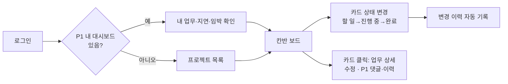
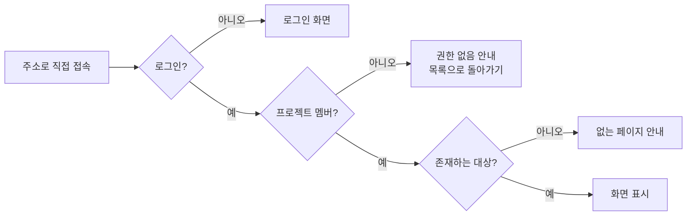

# 기능 스펙 (SPEC.md)

> 프로젝트: **동잇(Doing_It)** — 팀 협업 프로젝트 관리 시스템 | 버전: v0.5 (§11 수용 기준 목록 추가, 시나리오 84개로 보완) · v0.4 (모든 기능 설명을 '사용자는 [기능]을 통해 [목적]을 수행할 수 있다' 형식으로 통일) · v0.3 (Q2~Q7·Q9·Q10 결정 반영) · v0.2 (Q1·Q8·Q12 결정 반영) | 작성일: 2026-11-11(수)
> 단계: **Specify** — 무엇을·왜 만드는지 확정한다. **기술 결정(API 경로, 상태 코드, DB 구조, 라이브러리)은 이 문서에서 다루지 않는다.**
> 근거: [PROPOSAL.md](./PROPOSAL.md) · [CONSTITUTION.md](./CONSTITUTION.md) · [REQUIREMENTS.md](./REQUIREMENTS.md) v0.8 · [USER-STORIES.md](./USER-STORIES.md) v0.7
> 기능 ID(`AUTH-01` 등)·우선순위·스토리 번호(`US-xx`)는 REQUIREMENTS·USER-STORIES와 같다. 새 ID를 만들지 않으며, **기능 ID·우선순위가 다르면 REQUIREMENTS.md를 따른다.**
> 기술 상세는 [API-SPEC.md](./API-SPEC.md)(Day 3 이후 확정), [DATABASE-DESIGN.md](./DATABASE-DESIGN.md)에 둔다.

## 0. Day 2 작업 분담

| 담당 | 이름 (영역) | 작업 | 이 문서의 위치 |
| :-: | --- | --- | --- |
| A | 양준석 (백엔드) | 스펙 작성 총괄, 수용 기준 Given-When-Then 형식 통일, 범위 밖 항목 명시 | §1, §2, §8, 전체 검토 |
| B | 서승범 (백엔드) | F1 회원·인증, F4 콘텐츠·상호작용 | §3, §6 |
| C | 최진영 (프론트엔드) | F2 기본 자원 CRUD, F3 관계·참여, F5 부가 기능(검색·마이페이지) | §4, §5, §7 |
| D | 김서현 (프론트엔드) | 유저 플로우, Figma 와이어프레임 착수 | §9 |
| 전원 | | 스펙 리뷰, 모호한 항목을 질문 목록으로 만들어 해소 | §10 |

### 기능 설명 규칙

- 모든 기능은 **"사용자는 [기능]을 통해 [목적]을 수행할 수 있다"** 형식으로 설명한다. 역할이 제한된 기능은 `사용자(OWNER)는`처럼 괄호로 밝힌다.
- [기능]에는 무엇을 하는지(필요하면 괄호로 핵심 규칙), [목적]에는 그 기능으로 사용자가 얻는 것을 쓴다.

### 수용 기준 작성 규칙

- 형식: **Given**(주어진 상황) / **When**(사용자 행동) / **Then**(사용자가 보는 결과·시스템이 지키는 규칙)
- 결과는 **사용자가 관찰할 수 있는 말**로 쓴다. 상태 코드·테이블 이름은 쓰지 않는다.
- 시나리오 번호는 `기능 ID-영문 소문자`(예: `AUTH-01-a`)로 붙인다.
- 정상 경우 1개 이상 + **실패 경우(권한 없음·규칙 위반) 1개 이상**을 반드시 넣는다. 거절할 상황이 없는 조회·표시 기능은 **예외 경우(빈 상태·경계값)**로 대신한다.
- 전체 목록과 기능별 점검은 §11 수용 기준 목록에 모은다.

## 1. 목적 — 왜 만드는가

소규모 팀의 업무가 메신저와 개인 메모에 흩어져 **누가 무엇을 언제까지 하는지 한곳에서 볼 수 없다.**
동잇은 프로젝트 단위로 업무를 모으고, 상태·담당자·마감일을 한 화면에서 관리하게 해 아래 네 문제를 없앤다.

| 문제 | 해결하는 기능 그룹 |
| --- | --- |
| 업무 누락 | F2 업무 등록·칸반 |
| 진행 상황 불투명 | F5 진행률, F4 최근 활동 |
| 마감 놓침 | F5 마감 임박·지연 |
| 변경 이유 불명 | F4 변경 이력 |

## 2. 사용자와 역할

| 사용자 | 역할 | 할 수 있는 일 |
| --- | --- | --- |
| 방문자 | 로그인 전 | 회원가입, 로그인만 |
| 프로젝트 관리자 | OWNER | 프로젝트 수정·삭제, 멤버 추가·제거·역할 변경 + MEMBER가 하는 모든 일 |
| 팀원 | MEMBER | 프로젝트·멤버 조회, 업무 등록, **본인이 만든 업무 수정·삭제**, **본인이 담당한 업무 상태 변경**, 댓글 |
| 비멤버 | 로그인했지만 그 프로젝트 멤버가 아님 | 그 프로젝트의 어떤 정보도 볼 수 없음 |
| 시스템 관리자 | ADMIN | 계정 비활성화 (P2) |

공통 원칙: 화면에서 버튼을 숨기는 것은 편의일 뿐이며, **권한이 없는 행동은 서비스가 항상 거절한다.**

## 3. F1 회원·인증 (담당 B)

**목적:** 누가 무엇을 했는지 구분하고, 프로젝트 정보를 멤버에게만 보여 준다.

| 기능 ID | 기능 설명 — 사용자는 [기능]을 통해 [목적]을 수행할 수 있다 | 우선순위 | 스토리 |
| --- | --- | :-: | --- |
| AUTH-01 | 사용자는 **아이디·비밀번호·이름 회원가입**을 통해 **팀 프로젝트에 참여할 내 계정 만들기**를 수행할 수 있다. | P0 | US-01 |
| AUTH-02 | 사용자는 **아이디·비밀번호 로그인**을 통해 **내 프로젝트와 업무에 접근하기**를 수행할 수 있다. | P0 | US-02 |
| AUTH-03 | 사용자는 **비밀번호 원문을 저장하지 않는 가입·로그인**을 통해 **비밀번호 유출 걱정 없이 계정 보호하기**를 수행할 수 있다. | P0 | US-01 |
| AUTH-04 | 사용자는 **로그인 유지·로그아웃**을 통해 **새로고침해도 이어서 작업하고 원할 때 안전하게 끝내기**를 수행할 수 있다. | P0 | US-03 |
| AUTH-06 | 사용자는 **내 이름 수정**을 통해 **팀원이 나를 알아보게 하기**를 수행할 수 있다. | P1 | US-04 |
| AUTH-05 | 사용자는 **로그인 자동 연장**을 통해 **작업 중 갑자기 로그아웃되지 않고 계속 작업하기**를 수행할 수 있다. | P2 | US-25 |
| AUTH-07 | 사용자는 **비밀번호 변경**을 통해 **비밀번호가 노출됐을 때 계정 지키기**를 수행할 수 있다. | P2 | US-31 |
| AUTH-08 | 사용자는 **회원 탈퇴**를 통해 **더 이상 쓰지 않는 계정 정리하기**를 수행할 수 있다. | P2 | US-32 |

**규칙**
- 아이디: 영문 소문자·숫자 4~20자, 중복 불가. 대문자로 입력하면 소문자로 바꿔 저장한다(대소문자만 다르면 같은 아이디).
- 비밀번호: 8~64자(UTF-8 72바이트 이하). 이름: 1~50자, 중복 허용.
- 로그인은 2시간 동안 유지되고, 지나면 다시 로그인한다.
- 로그인 실패 시 아이디와 비밀번호 중 무엇이 틀렸는지 알려 주지 않는다.
- (P2) 비밀번호 변경과 회원 탈퇴는 현재 비밀번호를 다시 입력해야 한다. 비밀번호 찾기는 이메일이 없어 제공하지 않는다.
- (P2) 탈퇴하면 로그인할 수 없고 모든 프로젝트에서 빠진다. 작성한 업무·댓글·이력은 "탈퇴한 사용자"로 남고, 아이디는 재사용할 수 없다. 마지막 OWNER인 프로젝트가 있으면 탈퇴할 수 없다.

**수용 기준**
- `AUTH-01-a` **Given** 처음 방문한 사용자 **When** 올바른 아이디·비밀번호·이름으로 가입하면 **Then** 계정이 만들어지고 로그인 화면으로 이동한다.
- `AUTH-01-b` **Given** `jisoo01`이 이미 가입됨 **When** `JISOO01`로 가입하면 **Then** "이미 사용 중인 아이디입니다"가 아이디 입력칸 아래에 보이고 계정은 만들어지지 않는다.
- `AUTH-01-c` **Given** 가입 화면 **When** 아이디에 한글·특수문자를 넣거나 4자 미만, 비밀번호 8자 미만으로 가입하면 **Then** 해당 입력칸 아래에 오류가 보인다.
- `AUTH-03-a` **Given** 가입이 끝난 계정 **When** 저장된 정보를 확인하면 **Then** 비밀번호 원문은 어디에도 없고, 어떤 화면·응답에도 비밀번호 정보가 나오지 않는다.
- `AUTH-02-a` **Given** 가입한 사용자 **When** 올바른 아이디·비밀번호로 로그인하면 **Then** 프로젝트 목록 화면으로 이동한다(내 대시보드가 생기면 대시보드).
- `AUTH-02-b` **Given** 가입한 사용자 **When** 틀린 비밀번호 또는 없는 아이디로 로그인하면 **Then** "아이디 또는 비밀번호가 올바르지 않습니다" 한 가지 메시지만 보인다.
- `AUTH-02-c` **Given** 비활성화된 계정 **When** 올바른 비밀번호로 로그인하면 **Then** "사용할 수 없는 계정입니다"가 보이고 로그인되지 않는다.
- `AUTH-04-a` **Given** 로그인한 상태 **When** 새로고침하면 **Then** 로그인이 유지되고 화면 상단에 내 이름이 보인다.
- `AUTH-04-b` **Given** 로그인한 지 2시간이 지남 **When** 아무 기능이나 사용하면 **Then** 로그인 화면으로 이동한다.
- `AUTH-04-c` **Given** 로그인한 상태 **When** 로그아웃하면 **Then** 로그인 화면으로 이동하고, 뒤로 가기로도 이전 화면을 볼 수 없다.
- `AUTH-04-d` **Given** 로그인하지 않은 상태 **When** 프로젝트 화면 주소로 직접 들어가면 **Then** 로그인 화면으로 이동한다.
- `AUTH-06-a` (P1) **Given** 로그인한 사용자 **When** 이름을 바꾸면 **Then** 업무 담당자·댓글 작성자 표시에 바뀐 이름이 보인다.
- `AUTH-06-b` (P1) **Given** 이름 수정 화면 **When** 이름을 비우거나 51자 이상 입력하면 **Then** 입력칸 아래에 오류가 보이고 바뀌지 않는다.
- `AUTH-05-a` (P2) **Given** 로그인한 지 2시간 가까이 지나 계속 작업 중 **When** 기능을 사용하면 **Then** 로그아웃되지 않고 하던 작업이 이어진다.
- `AUTH-05-b` (P2) **Given** 로그아웃했거나 로그인 연장 기간이 끝남 **When** 기능을 사용하면 **Then** 연장되지 않고 로그인 화면으로 이동한다.
- `AUTH-07-a` (P2) **Given** 로그인한 사용자 **When** 현재 비밀번호를 틀리게 넣고 바꾸려 하면 **Then** "현재 비밀번호가 올바르지 않습니다"가 보이고 바뀌지 않는다. 맞게 넣으면 다음 로그인부터 새 비밀번호를 쓴다.
- `AUTH-08-a` (P2) **Given** 민호가 업무 2개 담당, 댓글 3개 작성 **When** 비밀번호를 입력하고 탈퇴하면 **Then** 로그아웃되고, 업무 2개는 "담당자 없음"이 되며, 댓글은 "탈퇴한 사용자"로 남는다. 같은 아이디로 로그인·가입할 수 없다.
- `AUTH-08-b` (P2) **Given** 지수가 어떤 프로젝트의 유일한 OWNER **When** 탈퇴하려 하면 **Then** "OWNER를 넘기거나 프로젝트를 삭제한 뒤 탈퇴할 수 있습니다"가 보이고 탈퇴되지 않는다.

## 4. F2 핵심 기능① 기본 자원 CRUD — 프로젝트·업무·칸반 (담당 C)

**목적:** 팀 업무를 프로젝트 단위로 모으고, 상태별로 한눈에 본다.

| 기능 ID | 기능 설명 — 사용자는 [기능]을 통해 [목적]을 수행할 수 있다 | 우선순위 | 스토리 |
| --- | --- | :-: | --- |
| PRJ-01 | 사용자는 **프로젝트 생성**(이름 1~30자, 설명, 시작일, 종료일)을 통해 **팀 업무를 한곳에 모을 공간 만들기**를 수행할 수 있다. | P0 | US-05 |
| PRJ-02 | 사용자는 **내 프로젝트 목록**을 통해 **참여 중인 프로젝트 중 어디부터 볼지 고르기**를 수행할 수 있다. | P0 | US-06 |
| PRJ-07 | 사용자(멤버)는 **프로젝트 상세 보기**(이름·설명·기간)를 통해 **프로젝트의 목적과 일정 확인하기**를 수행할 수 있다. | P0 | US-07 |
| PRJ-03 | 사용자(OWNER)는 **프로젝트 수정·삭제**를 통해 **바뀐 정보를 반영하거나 끝난 프로젝트 정리하기**를 수행할 수 있다. | P0 | US-08 |
| TASK-01 | 사용자(멤버)는 **업무 등록**(제목 1~30자, 설명, 담당자, 마감일, 우선순위)을 통해 **해야 할 일을 빠뜨리지 않고 팀에 알리기**를 수행할 수 있다. | P0 | US-11 |
| TASK-04 | 사용자는 **우선순위 4단계 지정**(낮음·보통·높음·긴급)을 통해 **급한 업무부터 처리하기**를 수행할 수 있다. | P0 | US-11 |
| TASK-02 | 사용자는 **상태 3단계 변경**(할 일·진행 중·완료, 어느 방향으로든)을 통해 **업무가 어디까지 진행됐는지 팀에 알리기**를 수행할 수 있다. | P0 | US-13 |
| TASK-05 | 사용자는 **칸반 보드**(상태별 컬럼, 버튼·드롭다운 상태 변경, 우선순위·마감일 순 정렬)를 통해 **프로젝트 전체 흐름을 한눈에 파악하기**를 수행할 수 있다. | P0 | US-12, US-13 |
| TASK-06 | 사용자는 **업무 상세·수정·삭제**를 통해 **업무 내용을 자세히 확인하고 최신 상태로 유지하기**를 수행할 수 있다. | P0 | US-14 |
| PRJ-06 | 사용자(OWNER)는 **프로젝트 보관**을 통해 **끝난 프로젝트를 지우지 않고 목록에서 숨기기**를 수행할 수 있다. | P2 | US-10 |
| TASK-08 | 사용자는 **드래그 앤 드롭**을 통해 **카드를 끌어 놓는 것만으로 상태 바꾸기**를 수행할 수 있다. | P2 | US-16 |

**규칙**
- 프로젝트를 만든 사람은 자동으로 그 프로젝트의 OWNER가 된다.
- 프로젝트를 삭제하면 그 안의 업무·댓글도 함께 사라진다. 되돌릴 수 없으므로 **프로젝트 이름을 입력해야** 삭제된다.
- 새 업무는 항상 "할 일" 상태로 시작하고, 우선순위를 고르지 않으면 "보통"이다.
- 칸반 카드 순서: 우선순위 높은 순 → 마감일 빠른 순 → 마감일 없는 카드는 맨 뒤.
- 업무 수정·삭제: OWNER는 모든 업무, MEMBER는 **본인이 만든 업무만**. 삭제 전 확인 창을 띄운다.
- 업무 상태 변경: OWNER, 업무를 만든 사람, **업무 담당자**가 할 수 있다. 담당자는 남이 만든 업무라도 상태만 바꿀 수 있다.
- 마감일은 과거 날짜도, 프로젝트 기간 밖의 날짜도 입력할 수 있다(과거 날짜는 바로 "지연"으로 표시).
- 두 사람이 같은 업무를 동시에 수정할 수 있다. 나중에 저장한 내용이 남고, 두 사람의 변경이 모두 이력에 기록된다(잠금·충돌 알림 없음).

**수용 기준**
- `PRJ-01-a` **Given** 로그인한 사용자 **When** 이름 "동잇 개발"로 프로젝트를 만들면 **Then** 목록에 나타나고 내 역할은 OWNER로 보인다.
- `PRJ-01-b` **Given** 프로젝트 생성 화면 **When** 이름을 비우거나 31자 이상 입력하면 **Then** "프로젝트 이름은 1~30자로 입력해 주세요"가 보이고 만들어지지 않는다. 입력칸에 남은 글자 수가 보인다.
- `PRJ-01-c` **Given** 프로젝트 생성 화면 **When** 종료일을 시작일보다 앞으로 입력하면 **Then** "종료일은 시작일 이후여야 합니다"가 보인다.
- `PRJ-02-a` **Given** 민호가 프로젝트 2개의 멤버 **When** 프로젝트 목록을 열면 **Then** 그 2개만 카드로 보이고 카드마다 이름·기간·내 역할이 보인다.
- `PRJ-02-b` **Given** 속한 프로젝트가 없음 **When** 목록을 열면 **Then** "프로젝트를 만들어 보세요" 안내와 생성 버튼이 보인다.
- `PRJ-07-a` **Given** 민호가 프로젝트 P의 멤버가 아님 **When** P의 주소로 들어가면 **Then** "접근 권한이 없습니다" 안내 화면이 보이고 P의 이름조차 보이지 않는다.
- `PRJ-03-a` **Given** 지수가 P의 OWNER **When** 프로젝트 이름을 입력하고 삭제하면 **Then** P와 P의 업무가 모든 멤버의 화면에서 사라진다.
- `PRJ-03-b` **Given** 민호가 P의 MEMBER **When** P를 수정·삭제하려 하면 **Then** 수정·삭제 버튼이 보이지 않고, 다른 방법으로 시도해도 거절된다.
- `TASK-01-a` **Given** 민호가 P의 멤버 **When** 제목·담당자·마감일·우선순위 "높음"으로 업무를 등록하면 **Then** "할 일" 컬럼의 정렬 규칙에 맞는 자리에 카드가 생긴다.
- `TASK-01-b` **Given** 업무 등록 화면 **When** 제목을 비우거나 31자 이상 입력하면 **Then** "업무 제목은 1~30자로 입력해 주세요"가 보인다.
- `TASK-01-c` **Given** 오늘이 11/12 **When** 마감일 11/10으로 업무를 등록하면 **Then** 등록되고 카드가 빨간색(지연)으로 보인다.
- `TASK-04-a` **Given** 업무 등록 화면 **When** 우선순위를 고르지 않고 등록하면 **Then** "보통"으로 등록된다.
- `TASK-04-b` **Given** 우선순위 선택지 **When** 열면 **Then** 낮음·보통·높음·긴급 4개만 보이고, 다른 값으로 저장하려 하면 거절된다.
- `TASK-06-f` **Given** 지수와 민호가 같은 업무 상세를 열어 둠 **When** 지수가 마감일을, 이어서 민호가 상태를 저장하면 **Then** 두 변경이 모두 반영되고 이력이 2건 남는다. 같은 항목을 둘 다 바꾸면 나중에 저장한 값이 남는다.
- `TASK-05-a` **Given** 업무가 여러 개인 프로젝트 **When** 칸반 보드를 열면 **Then** "할 일 / 진행 중 / 완료" 3개 컬럼이 보이고, 카드마다 제목·담당자·마감일·우선순위가 보인다.
- `TASK-05-b` **Given** 마감일이 지난 미완료 카드, 3일 이내 미완료 카드 **When** 보드를 보면 **Then** 각각 빨간색, 주황색으로 표시된다.
- `TASK-02-a` **Given** "할 일" 상태의 카드 **When** 상태 드롭다운에서 "진행 중"을 고르면 **Then** 카드가 "진행 중" 컬럼으로 옮겨진다. "완료" → "할 일"처럼 거꾸로도 바꿀 수 있다.
- `TASK-02-b` **Given** 지수가 만들고 민호에게 배정한 업무 **When** 민호가 상태를 "진행 중"으로 바꾸면 **Then** 바뀐다.
- `TASK-02-c` **Given** 서연이 작성자도 담당자도 아닌 업무 **When** 서연이 카드를 보면 **Then** 상태 드롭다운이 비활성화되어 있고, 다른 방법으로 바꾸려 해도 거절된다.
- `TASK-06-a` **Given** 카드 **When** 클릭하면 **Then** 상세 창이 열리고, 그 주소를 새로고침하거나 공유해도 같은 상세 창이 열린다.
- `TASK-06-b` **Given** 민호가 MEMBER이고 지수가 만든 업무 **When** 민호가 삭제하려 하면 **Then** 거절되고 업무는 그대로 남는다.
- `TASK-06-d` **Given** 지수가 만들고 민호에게 배정한 업무 **When** 민호가 상세를 열면 **Then** 상태만 바꿀 수 있고 제목·설명·담당자·마감일·우선순위는 읽기 전용이다. 다른 방법으로 바꾸려 해도 거절된다.
- `TASK-06-e` **Given** 지수(OWNER) **When** 민호가 만든 업무를 수정·삭제하면 **Then** 된다.
- `TASK-06-c` **Given** 업무 상세 **When** 삭제를 누르면 **Then** "이 업무를 삭제할까요?" 확인 창이 뜨고, 확인해야 삭제된다.
- `PRJ-06-a` (P2) **Given** 지수가 끝난 프로젝트의 OWNER **When** 보관하면 **Then** 목록에서 사라지고 "보관된 프로젝트"에서만 보이며, 그 안의 업무는 읽기 전용이 된다.
- `PRJ-06-b` (P2) **Given** 민호가 MEMBER **When** 프로젝트를 보관하려 하면 **Then** 보관 버튼이 보이지 않고, 다른 방법으로 시도해도 거절된다.
- `TASK-08-a` (P2) **Given** 칸반 보드 **When** "할 일" 카드를 "진행 중" 컬럼으로 끌어다 놓으면 **Then** 상태가 바뀌고, 드롭다운으로 바꾼 것과 똑같이 이력이 남는다.
- `TASK-08-b` (P2) **Given** 서연이 작성자도 담당자도 아닌 카드 **When** 다른 컬럼으로 끌어다 놓으면 **Then** 카드가 원래 자리로 돌아가고 "상태를 바꿀 권한이 없습니다"가 보인다.

## 5. F3 핵심 기능② 관계·참여 — 멤버와 담당자 (담당 C)

**목적:** 같은 프로젝트에 참여한 사람끼리만 업무를 나누고, 업무마다 책임자를 정한다.

| 기능 ID | 기능 설명 — 사용자는 [기능]을 통해 [목적]을 수행할 수 있다 | 우선순위 | 스토리 |
| --- | --- | :-: | --- |
| PRJ-04 | 사용자(OWNER)는 **아이디로 멤버 추가**(역할 지정)를 통해 **팀원과 함께 업무 관리하기**를 수행할 수 있다. | P0 | US-07 |
| PRJ-07 | 사용자(멤버)는 **멤버 목록 보기**(이름·아이디·역할)를 통해 **누가 참여하는지 확인하고 담당자 고르기**를 수행할 수 있다. | P0 | US-07 |
| PRJ-05 | 사용자(OWNER)는 **멤버 제거**를 통해 **잘못 추가했거나 팀을 떠난 사람의 접근 막기**를 수행할 수 있다. | P0 | US-09 |
| TASK-03 | 사용자는 **프로젝트 멤버 중 담당자 지정**을 통해 **업무마다 책임자를 분명히 하기**를 수행할 수 있다. | P0 | US-11 |
| PRJ-08 | 사용자(OWNER)는 **멤버 역할 변경**을 통해 **관리 권한을 다른 팀원과 나누거나 넘기기**를 수행할 수 있다. | P1 | US-26 |
| PRJ-09 | 사용자(멤버)는 **프로젝트 나가기**를 통해 **더 이상 참여하지 않는 프로젝트를 내 목록에서 정리하기**를 수행할 수 있다. | P2 | US-33 |

**규칙**
- 프로젝트에는 **OWNER가 항상 1명 이상** 있어야 한다.
- 멤버를 제거하면 그 사람이 담당하던 업무는 "담당자 없음"이 되고, 이 변화도 변경 이력에 남는다.
- 제거된 사람은 즉시 그 프로젝트를 볼 수 없다.
- 멤버로 추가될 때 따로 알림이나 수락 절차는 없다. 다음에 목록을 열면 보인다(알림은 보류).
- (P2) 멤버는 스스로 나갈 수 있다. 마지막 OWNER는 나갈 수 없고, 나간 사람이 담당하던 업무는 제거와 똑같이 처리한다.

**수용 기준**
- `PRJ-04-a` **Given** 지수가 P의 OWNER, `minho`가 가입한 회원 **When** 아이디 `minho`, 역할 MEMBER로 추가하면 **Then** 민호의 프로젝트 목록에 P가 바로 나타난다.
- `PRJ-04-b` **Given** 지수가 OWNER **When** 가입하지 않은 아이디로 추가하면 **Then** "해당 아이디의 회원이 없습니다"가 보인다.
- `PRJ-04-c` **Given** 민호가 이미 멤버 **When** 다시 추가하면 **Then** "이미 프로젝트 멤버입니다"가 보인다.
- `PRJ-04-d` **Given** 민호가 MEMBER **When** 멤버를 추가하려 하면 **Then** 추가 버튼이 보이지 않고, 다른 방법으로 시도해도 거절된다.
- `PRJ-07-b` **Given** 민호가 MEMBER **When** 설정 화면을 열면 **Then** 멤버 목록(이름·아이디·역할)은 보이지만 추가·제거 버튼은 보이지 않는다.
- `PRJ-05-a` **Given** 민호가 업무 2개의 담당자 **When** 지수가 민호를 제거하면 **Then** 민호의 목록에서 P가 사라지고, 그 업무 2개는 "담당자 없음"이 된다.
- `PRJ-05-b` **Given** OWNER가 지수 1명뿐 **When** 지수가 자신을 제거하면 **Then** "OWNER는 최소 1명 있어야 합니다"가 보이고 제거되지 않는다.
- `TASK-03-a` **Given** 업무 등록·수정 화면 **When** 담당자 선택지를 열면 **Then** 이 프로젝트 멤버만 보인다.
- `TASK-03-b` **Given** 서연이 P의 멤버가 아님 **When** 어떤 방법으로든 서연을 P 업무의 담당자로 지정하면 **Then** "담당자는 프로젝트 멤버여야 합니다"로 거절된다.
- `PRJ-08-a` (P1) **Given** OWNER가 지수 1명뿐 **When** 지수가 자신을 MEMBER로 바꾸면 **Then** 거절된다. 민호를 OWNER로 바꾼 뒤에는 가능하다.
- `PRJ-09-a` (P2) **Given** 서연이 MEMBER로 업무 1개 담당 **When** "프로젝트 나가기"를 확인하면 **Then** 서연의 목록에서 프로젝트가 사라지고 그 업무는 "담당자 없음"이 된다.
- `PRJ-09-b` (P2) **Given** 지수가 유일한 OWNER **When** 나가려 하면 **Then** "OWNER는 최소 1명 있어야 합니다"가 보이고 나가지지 않는다.

## 6. F4 핵심 기능③ 콘텐츠·상호작용 — 변경 이력·댓글·체크리스트 (담당 B)

**목적:** 업무에 대한 대화와 변경 기록을 업무 옆에 남겨, 메신저를 뒤지거나 회의하지 않아도 경위를 알 수 있게 한다. **변경 이력은 차별화 기능이다.**

| 기능 ID | 기능 설명 — 사용자는 [기능]을 통해 [목적]을 수행할 수 있다 | 우선순위 | 스토리 |
| --- | --- | :-: | --- |
| LOG-01 | 사용자는 **업무 변경 이력 자동 기록**(생성, 상태·담당자·마감일·우선순위 변경, 삭제)을 통해 **따로 적지 않아도 변경 경위 남기기**를 수행할 수 있다. | P0 | US-18 |
| LOG-02 | 사용자는 **이력 상세 항목**(누가, 무엇을, 이전 값 → 새 값, 언제)을 통해 **누가 언제 무엇을 바꿨는지 추적하기**를 수행할 수 있다. | P0 | US-18 |
| LOG-03 | 사용자는 **업무별 이력·프로젝트 최근 활동 20건 보기**를 통해 **회의 없이 최근 변화 파악하기**를 수행할 수 있다. | P1 | US-27, US-19 |
| CMT-01 | 사용자는 **업무 댓글 작성·조회**(1~300자)를 통해 **메신저 없이 업무 옆에서 질문·메모 주고받기**를 수행할 수 있다. | P1 | US-17 |
| CMT-02 | 사용자는 **본인 댓글 수정·삭제**를 통해 **잘못 쓴 내용 바로잡기**를 수행할 수 있다. | P1 | US-17 |
| TASK-09 | 사용자는 **업무 체크리스트**(todo, 업무당 최대 10개)를 통해 **업무를 작은 할 일로 나눠 빠짐없이 처리하기**를 수행할 수 있다. | P2 | US-28 |
| TASK-10 | 사용자는 **업무 진행률**(체크한 항목 / 전체 항목)을 통해 **진행 중인 업무가 얼마나 끝났는지 확인하기**를 수행할 수 있다. | P2 | US-29 |

**규칙**
- 이력은 **사람이 따로 남기지 않아도 자동으로** 기록된다. 업무 변경이 실패하면 이력도 남지 않는다.
- 한 번에 여러 항목을 바꾸면 항목마다 따로 기록된다. 제목·설명 변경은 기록하지 않는다.
- 업무가 삭제돼도 그 업무의 이력은 남는다.
- 댓글은 OWNER라도 남의 것을 수정·삭제할 수 없다.
- 체크리스트는 OWNER, 업무 작성자, 업무 담당자만 바꿀 수 있고 다른 멤버는 보기만 한다. 체크리스트 변경은 이력에 남기지 않는다. 업무 진행률이 100%가 돼도 상태는 자동으로 바뀌지 않는다.

**수용 기준**
- `LOG-01-a` **Given** "할 일" 업무 **When** 민호가 "진행 중"으로 바꾸면 **Then** 이력 1건(민호 · 상태 · 할 일 → 진행 중 · 시각)이 남는다.
- `LOG-01-b` **Given** 업무 **When** 상태와 담당자를 한 번에 바꾸면 **Then** 이력이 2건 남는다.
- `LOG-01-c` **Given** 업무 **When** 삭제하면 **Then** "삭제됨" 이력이 남고, 업무가 사라진 뒤에도 프로젝트 최근 활동에서 보인다.
- `LOG-01-d` **Given** 업무 **When** 제목만 바꾸면 **Then** 이력은 남지 않는다.
- `LOG-01-e` **Given** 업무 변경 중 오류 발생 **When** 변경이 실패하면 **Then** 업무도 이력도 바뀌지 않는다.
- `LOG-02-a` **Given** 지수가 업무 마감일을 11/20에서 11/25로 바꿈 **When** 그 이력을 확인하면 **Then** 변경자(지수), 항목(마감일), 이전 값(11/20), 새 값(11/25), 변경 시각 다섯 가지가 모두 남아 있다.
- `LOG-02-b` **Given** 담당자를 해제하거나 업무를 삭제함 **When** 이력을 확인하면 **Then** 담당자 해제는 새 값이 "없음"으로, 삭제는 삭제 전 업무 제목이 남아 무엇이 지워졌는지 알 수 있다.
- `LOG-03-a` (P1) **Given** 마감일이 11/20 → 11/25로 바뀐 업무 **When** 상세의 이력 탭을 열면 **Then** "민호 · 마감일 11/20 → 11/25 · 방금 전"이 최신순으로 보인다.
- `LOG-03-b` (P1) **Given** 프로젝트 통계 화면 **When** 최근 활동을 보면 **Then** 최근 20건이 최신순으로 보이고, 항목을 누르면 해당 업무 상세가 열린다(삭제된 업무 제외).
- `LOG-03-c` (P1) **Given** 서연이 프로젝트 P의 멤버가 아님 **When** P의 업무 이력이나 최근 활동을 보려 하면 **Then** "접근 권한이 없습니다" 안내가 보이고 이력은 보이지 않는다.
- `CMT-01-a` (P1) **Given** 업무 상세 **When** 댓글을 쓰면 **Then** 작성자·시각과 함께 오래된 순 목록 맨 아래에 보인다.
- `CMT-01-b` (P1) **Given** 댓글 입력칸 **When** 비어 있거나 300자를 넘는 댓글을 보내면 **Then** 등록되지 않고 안내가 보인다. 입력칸에 남은 글자 수가 보인다.
- `CMT-02-a` (P1) **Given** 지수(OWNER)가 민호의 댓글을 봄 **When** 수정·삭제하려 하면 **Then** 버튼이 보이지 않고, 다른 방법으로 시도해도 거절된다.
- `TASK-09-a` (P2) **Given** 업무 상세 **When** 할 일 항목 "API 문서 확인"을 추가하고 체크하면 **Then** 항목이 체크 표시로 바뀐다.
- `TASK-09-b` (P2) **Given** 항목이 이미 10개 **When** 11번째를 추가하려 하면 **Then** 추가 버튼이 비활성화되어 있고, 다른 방법으로 시도해도 "체크리스트는 업무당 10개까지입니다"로 거절된다.
- `TASK-10-a` (P2) **Given** 항목 5개 중 2개 체크 **When** 카드를 보면 **Then** "2/5 (40%)"가 보인다. 항목이 없는 업무에는 진행률이 보이지 않는다.

## 7. F5 부가 기능 — 검색·마이페이지·현황 (담당 C)

**목적:** 업무가 많아져도 필요한 것만 골라 보고, 로그인하자마자 내 할 일과 마감 위험을 확인한다. **마감 임박·지연은 차별화 기능이다.**

| 기능 ID | 기능 설명 — 사용자는 [기능]을 통해 [목적]을 수행할 수 있다 | 우선순위 | 스토리 |
| --- | --- | :-: | --- |
| TASK-07 | 사용자는 **검색·필터**(제목 키워드·담당자·상태·우선순위·마감일 범위)를 통해 **필요한 업무만 골라 보기**를 수행할 수 있다. | P1 | US-15 |
| DASH-04 | 사용자는 **마이페이지(내 대시보드)**를 통해 **여러 프로젝트를 돌아다니지 않고 내 할 일부터 확인하기**를 수행할 수 있다. | P1 | US-23 |
| DASH-01 | 사용자는 **프로젝트 진행률**(완료 업무 / 전체 업무)을 통해 **프로젝트가 얼마나 진행됐는지 숫자로 확인하기**를 수행할 수 있다. | P1 | US-20 |
| DASH-03 | 사용자는 **마감 임박·지연 목록**(임박: 오늘~오늘+3일, 지연: 어제 이전)을 통해 **마감을 놓치기 전에 챙기기**를 수행할 수 있다. | P1 | US-22 |
| DASH-02 | 사용자는 **담당자별 상태별 업무 수**를 통해 **한 사람에게 일이 몰리지 않게 나누기**를 수행할 수 있다. | P1 | US-21 |
| TASK-11 | 사용자는 **마감일 기준 월간 달력**을 통해 **이번 달 마감 일정이 언제 몰리는지 확인하기**를 수행할 수 있다. | P2 | US-30 |
| ADM-01 | 사용자(ADMIN)는 **전체 사용자 조회·계정 비활성화**를 통해 **문제가 있는 계정의 사용 막기**를 수행할 수 있다. | P2 | US-24 |

**규칙**
- 마감 임박·지연에는 **완료되지 않았고 마감일이 있는** 업무만 나온다. **마감일이 오늘인 업무는 임박**이다.
- 업무가 없는 프로젝트의 진행률은 0%다.
- 필터 조건은 주소에 남아, 주소를 공유하면 같은 결과가 보인다.

**수용 기준**
- `TASK-07-a` **Given** 업무 30개 **When** 담당자 "민호" + 우선순위 "긴급"으로 거르면 **Then** 두 조건을 모두 만족하는 카드만 보인다.
- `TASK-07-b` **Given** 필터가 적용된 화면 **When** 주소를 복사해 다른 팀원에게 보내면 **Then** 같은 결과가 보인다. "필터 초기화"를 누르면 전체가 다시 보인다.
- `TASK-07-c` **Given** 업무 30개 **When** 어떤 업무와도 맞지 않는 조건으로 거르면 **Then** "조건에 맞는 업무가 없습니다"와 "필터 초기화" 버튼이 보인다.
- `DASH-04-a` **Given** 민호에게 3개 프로젝트에 걸쳐 업무가 있음 **When** 로그인하면 **Then** 첫 화면에 내 미완료 업무가 프로젝트 이름과 함께 마감일 순으로 보이고, 지연·임박 업무가 맨 위에 강조된다.
- `DASH-04-b` **Given** 민호에게 할당된 업무가 모두 완료됐거나 없음 **When** 첫 화면을 열면 **Then** "할당된 업무가 없습니다" 안내가 보이고, 완료된 업무는 목록에 나오지 않는다.
- `DASH-01-a` **Given** 업무 10개 중 4개 완료 **When** 프로젝트 목록·칸반을 보면 **Then** 진행률 40%가 보인다. 업무가 없으면 0%.
- `DASH-03-a` **Given** 오늘이 11/12, 마감일 11/11(미완료)·11/12(미완료)·11/15(미완료)·11/16(미완료)·11/13(완료)·마감일 없음 업무 **When** 마감 현황을 보면 **Then** 11/11은 "지연", 11/12·11/15는 "임박"에 나오고, 나머지 셋은 나오지 않는다.
- `DASH-02-a` **Given** 담당자가 없는 업무 포함 **When** 통계 화면을 보면 **Then** 담당자 × 상태 표가 보이고 "담당자 없음"도 따로 집계된다.
- `TASK-11-a` (P2) **Given** 이번 달 마감 업무 **When** 달력을 열면 **Then** 마감일 칸에 업무 제목이 보이고, 누르면 상세가 열린다. 마감일 없는 업무는 보이지 않는다.
- `ADM-01-a` (P2) **Given** 일반 사용자 **When** 관리자 기능에 접근하면 **Then** 거절된다.

## 8. 범위 밖 (담당 A)

### 8.1 이번 프로젝트에서 만들지 않음 (Won't)

| 항목 | 이유 |
| --- | --- |
| 실시간 알림(WebSocket) | 92시간 범위 초과. 새로고침으로 확인 |
| 이메일 발송 | 외부 서비스 필요. 가입·초대 모두 아이디로 처리 |
| 파일 첨부 | 저장소·용량 관리 범위 초과 |
| 외부 서비스 연동 | 범위 초과 |
| LLM, RAG, LangChain, AI 에이전트, AI 모델 학습 등 AI 기능 | 과정 제외 기술. AI는 코딩 도구로만 사용 |
| 보기 전용 역할(VIEWER) | 보류, 추후 재검토 |
| 멤버 추가 알림 | 보류(Q6). 실시간 알림·이메일이 범위 밖이라 다음 접속 때 목록으로 확인 |

### 8.2 명세에 없어 만들지 않는 것 (확인 필요 — §10 질문 목록)

비밀번호 찾기(이메일 없음), 아이디 변경, 초대 수락·거절 절차(추가 즉시 멤버가 됨), 동시 수정 잠금·충돌 알림, 업무 복구(삭제는 되돌릴 수 없음), 업무 간 연결·하위 업무, 반복 업무, 모바일 전용 화면(데스크톱 기준 반응형만)

## 9. 유저 플로우 (담당 D)

> Figma 와이어프레임: _(링크 추가 예정)_ · 화면 목록은 [REQUIREMENTS.md §6](./REQUIREMENTS.md#6-주요-화면-목록)

### 9.1 처음 사용하는 팀장 (P0)

### 9.2 팀원의 하루 (P0 → P1)

### 9.3 접근 제한

## 10. 질문 목록 — 모호점·누락 시나리오 (전원)

> 리뷰에서 답을 정하면 "결정" 칸을 채우고 해당 절과 REQUIREMENTS·USER-STORIES에 반영한다.

| # | 기능 | 질문 | 초안 제안 | 결정 |
| :-: | --- | --- | --- | --- |
| Q1 | DASH-03 | "3일 이내"는 오늘 포함 며칠까지인가? 마감일이 오늘인 업무는 임박인가 지연인가? | 오늘 ~ 오늘+3일은 임박, 어제까지는 지연. "오늘"은 한국 날짜 기준 | ✅ 마감일이 오늘이면 **임박** (11/11). "오늘"은 한국 날짜(UTC+9)로 확정 (11/12, API-SPEC §1.6) |
| Q2 | TASK-01 | 마감일을 과거 날짜로 입력할 수 있는가? 프로젝트 기간 밖이어도 되는가? | 둘 다 허용(지연으로 표시됨) | ✅ 과거 마감일 **허용**. 기간 밖도 초안대로 허용 (11/11) |
| Q3 | PRJ-05 | MEMBER가 스스로 프로젝트에서 나갈 수 있는가? | 이번 범위 밖(OWNER가 제거) | ✅ **나갈 수 있음** → PRJ-09 신설(P2). 마지막 OWNER는 불가 (11/11) |
| Q4 | AUTH | 비밀번호 변경·찾기, 회원 탈퇴가 필요한가? | 이번 범위 밖(이메일이 없어 찾기 불가) | ✅ 비밀번호 **변경**(AUTH-07)·회원 **탈퇴**(AUTH-08) 신설(P2). 비밀번호 찾기는 범위 밖 (11/11) |
| Q5 | TASK-06 | 두 사람이 같은 업무를 동시에 수정하면? | 나중에 저장한 내용이 남음. 이력에 둘 다 기록 | ✅ 동시 수정 **가능**, 잠금 없음 (11/11) |
| Q6 | PRJ-04 | 추가된 사람에게 알림이 가는가? 수락 절차가 있는가? | 알림·수락 없음. 다음 접속 때 목록에 보임 | ⏸ 알림 **보류**(§8.1). 수락 절차 없음 (11/11) |
| Q7 | ADM-01 | 비활성화된 사용자가 담당하던 업무와 멤버 자격은? | 그대로 유지, 로그인만 막음 | ⏸ **보류** — ADM-01(P2) 착수 때 결정 (11/11) |
| Q8 | TASK-06 | MEMBER가 남이 만든 업무를 **수정**하는 것은 허용인가? | 허용(권한 매트릭스: 업무 수정은 OWNER·MEMBER 모두 O) | ✅ **불허**. MEMBER는 본인 작성 업무만 수정·삭제, 본인 담당 업무는 상태만 변경 (11/11) |
| Q9 | CMT-01 | 댓글 최대 길이, 수정하면 "수정됨" 표시를 하는가? | 1000자, "수정됨" 표시 | ✅ **300자** 이내 (11/11). 수정한 댓글은 "수정됨" 표시 (11/12) |
| Q10 | TASK-09 | 업무당 체크리스트 항목 수 제한이 있는가? | 제한 없음(필요하면 P2 착수 때 결정) | ✅ 업무당 **10개** 이내 (11/11) |
| Q11 | PRJ-02 | 프로젝트 목록 정렬 기준은? | 최근에 만든 순 | ✅ **최근에 만든 순** (11/12) |
| Q12 | 공통 | A~D 역할과 팀원 이름 연결 | — | ✅ A 양준석·B 서승범(백엔드), C 최진영·D 김서현(프론트엔드) (11/11) |

## 11. 수용 기준 목록 (전원 점검용)

> 기능 38개 · 시나리오 **84개**. 시나리오 본문은 각 F 절에 있다. 기능을 추가하거나 시나리오를 바꾸면 이 표도 함께 고친다.
> 정상 = 기능이 의도대로 동작 · 실패 = 권한 없음·규칙 위반으로 거절 · 예외 = 빈 상태·경계값 (거절할 상황이 없는 기능)

| 그룹 | 기능 ID | 우선순위 | 시나리오 | 수 | 정상 | 실패 / 예외 |
| --- | --- | :-: | --- | :-: | --- | --- |
| F1 | AUTH-01 | P0 | a, b, c | 3 | a | 실패 b(아이디 중복), c(형식 위반) |
| F1 | AUTH-02 | P0 | a, b, c | 3 | a | 실패 b(틀린 정보), c(비활성 계정) |
| F1 | AUTH-03 | P0 | a | 1 | — | 예외 a(비밀번호 정보 비노출 보장) |
| F1 | AUTH-04 | P0 | a, b, c, d | 4 | a, c | 실패 b(만료), d(비로그인 접근) |
| F1 | AUTH-06 | P1 | a, b | 2 | a | 실패 b(길이 위반) |
| F1 | AUTH-05 | P2 | a, b | 2 | a | 실패 b(연장 불가) |
| F1 | AUTH-07 | P2 | a | 1 | a | 실패 a(현재 비밀번호 틀림) |
| F1 | AUTH-08 | P2 | a, b | 2 | a | 실패 b(마지막 OWNER) |
| F2 | PRJ-01 | P0 | a, b, c | 3 | a | 실패 b(이름 길이), c(기간 역전) |
| F2 | PRJ-02 | P0 | a, b | 2 | a | 예외 b(프로젝트 없음) |
| F2 | PRJ-07 | P0 | a (F2), b (F3) | 2 | b | 실패 a(비멤버 접근) |
| F2 | PRJ-03 | P0 | a, b | 2 | a | 실패 b(MEMBER 수정·삭제) |
| F2 | TASK-01 | P0 | a, b, c | 3 | a, c | 실패 b(제목 길이) |
| F2 | TASK-04 | P0 | a, b | 2 | a | 실패 b(정의 외 값) |
| F2 | TASK-02 | P0 | a, b, c | 3 | a, b | 실패 c(권한 없는 상태 변경) |
| F2 | TASK-05 | P0 | a, b | 2 | a, b | 실패는 TASK-02-c·PRJ-07-a로 확인 |
| F2 | TASK-06 | P0 | a, b, c, d, e, f | 6 | a, c, e, f | 실패 b(남의 업무 삭제), d(담당자의 상태 외 수정) |
| F2 | PRJ-06 | P2 | a, b | 2 | a | 실패 b(MEMBER 보관) |
| F2 | TASK-08 | P2 | a, b | 2 | a | 실패 b(권한 없는 카드 이동) |
| F3 | PRJ-04 | P0 | a, b, c, d | 4 | a | 실패 b(없는 아이디), c(이미 멤버), d(MEMBER 추가) |
| F3 | PRJ-05 | P0 | a, b | 2 | a | 실패 b(마지막 OWNER) |
| F3 | TASK-03 | P0 | a, b | 2 | a | 실패 b(비멤버 담당자) |
| F3 | PRJ-08 | P1 | a | 1 | a | 실패 a(마지막 OWNER 강등) |
| F3 | PRJ-09 | P2 | a, b | 2 | a | 실패 b(마지막 OWNER) |
| F4 | LOG-01 | P0 | a, b, c, d, e | 5 | a, b, c | 예외 d(기록 대상 아님), 실패 e(변경 실패 시 이력 없음) |
| F4 | LOG-02 | P0 | a, b | 2 | a | 예외 b(담당 해제·삭제 값) |
| F4 | LOG-03 | P1 | a, b, c | 3 | a, b | 실패 c(비멤버 조회) |
| F4 | CMT-01 | P1 | a, b | 2 | a | 실패 b(빈 댓글·300자 초과) |
| F4 | CMT-02 | P1 | a | 1 | — | 실패 a(남의 댓글 수정·삭제) |
| F4 | TASK-09 | P2 | a, b | 2 | a | 실패 b(10개 초과) |
| F4 | TASK-10 | P2 | a | 1 | a | 예외 a(항목 없음 → 미표시) |
| F5 | TASK-07 | P1 | a, b, c | 3 | a, b | 예외 c(결과 없음) |
| F5 | DASH-04 | P1 | a, b | 2 | a | 예외 b(할당 업무 없음) |
| F5 | DASH-01 | P1 | a | 1 | a | 예외 a(업무 없음 → 0%) |
| F5 | DASH-03 | P1 | a | 1 | a | 예외 a(오늘·+3일·+4일 경계, 완료·마감일 없음 제외) |
| F5 | DASH-02 | P1 | a | 1 | a | 예외 a(담당자 없음 집계) |
| F5 | TASK-11 | P2 | a | 1 | a | 예외 a(마감일 없음 미표시) |
| F5 | ADM-01 | P2 | a | 1 | — | 실패 a(일반 사용자 접근) |

**점검 결과:** 기능 38개 모두 시나리오 1개 이상, 거절할 상황이 있는 기능은 모두 실패 경우 포함. P0 기능 18개 · 시나리오 51개.
