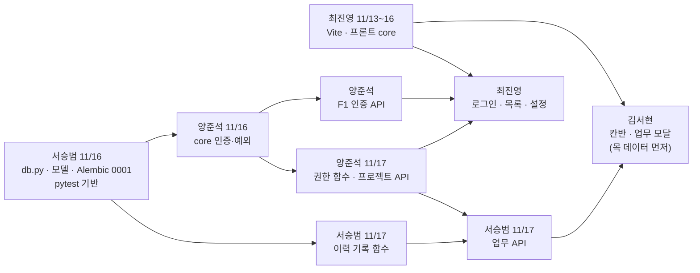

# 태스크 분해 (TASKS.md)

> 프로젝트: 동잇(Doing_It) | 버전: v1.3 (2026-11-16 §3 업무용 배지 위치 `features/tasks`, SPEC-CHANGELOG #9) · v1.2 (2026-11-16 완료 태스크 ✅ 표시, T-F1-01 완료, T-F1-06 완료 기준 51자로 수정) · v1.1 (2026-11-16 실제 진행 반영: D4-01·02 완료, 개발 로그 파일명 한국 이름) · v1.0 (**2026-11-16 회의 채택**) · v0.3 (제안) | 작성일: 2026-11-13 · 수정일: 2026-11-16
> 근거: 과정 일별 가이드(1~12일차) · REQUIREMENTS v1.0(기능 ID·우선순위) · SPEC v1.0 §3~§7(F1~F5) · ARCHITECTURE · DATABASE-DESIGN · UI-DESIGN · PROPOSAL §7(P1 순서)
> **분담 방식:** 백엔드 1명 + 프론트 1명을 짝으로 묶어 기능 영역을 통째로 맡는다(A조·B조). 리뷰는 **짝끼리 영역을 교차**해서 하고, 검증은 **상대 조**가 한다. 팀장 부재 시 **예비(서승범)**가 병합·회의·변경 이력 승인을 대신한다.
> 11/16 채택에 따라 CONSTITUTION §3, PROPOSAL §8, UI-DESIGN §2(담당 칸), ARCHITECTURE §8, PROJECT-OVERVIEW, README의 역할을 이 문서에 맞췄다.

## 1. 역할

| 짝 | 이름 | 영역 | P0 기능 | P1 기능 | 그 외 |
| --- | --- | --- | --- | --- | --- |
| **A조** | 양준석 | BE-A · **팀장** | AUTH-01~04, PRJ-01~05·07, 권한 함수, 백엔드 `core/` | DASH-01·03·04 (2순위: AUTH-06, PRJ-08, DASH-02) | 회의·병합·명세 결정, 보고서 전부, 일관성 점검·스펙 동결 |
| **A조** | 최진영 | FE-A | 로그인·회원가입·프로젝트 목록·설정 화면, 프론트 `core/`·공통 레이아웃 | 진행률·통계 탭·내 대시보드 화면 (2순위: 이름·역할 변경 화면) | 공통 컴포넌트 목록, B조 기능 검증, 발표 자료 |
| **B조** | 서승범 | BE-B · DB·테스트 · **예비 팀장** | DB·마이그레이션, TASK-01~06, LOG-01·02, pytest 기반, seed | TASK-07, LOG-03, CMT-01·02 | 팀장 부재 시 대행(§2), 쿼리 최적화, README 설치 |
| **B조** | 김서현 | FE-B | 칸반·업무 등록·업무 상세, 업무용 배지, 403·404 화면 | 검색·필터 바, 이력 탭, 댓글 | Git·PR 규칙·이슈 보드, Postman(업무·F4), A조 기능 검증, 사용자 매뉴얼, 발표 자료 |

- **P1은 화면 위치로 나눈다.** 칸반·업무 상세 안에 붙는 기능(검색·이력·댓글)은 B조, 별도 화면·카드(진행률·통계·대시보드)는 A조. 한 화면 파일을 두 조가 같이 고치지 않기 위해서다.
- **팀장은 선행 코딩을 줄인다.** 그래서 `core/db.py`는 서승범이 맡는다.

## 2. 팀장 업무와 예비 대행

| 업무 | 평소 | 팀장 부재 시 |
| --- | --- | --- |
| 아침 10분 회의 진행 | 양준석 | 서승범 |
| PR 병합 순서·충돌 정리 | 양준석 | 서승범 |
| 스펙 변경 이력 승인 (작성은 바꾼 사람) | 양준석 | 서승범 |
| `TASKS.md` 진행 현황 확인 | 양준석 | 서승범 |
| 명세 수정 결정 (API·범위 변경) | 양준석 | **미룸.** 급하면 해당 짝 두 명이 합의하고 스펙 변경 이력에 "팀장 확인 필요"로 남긴다 |
| 보고서 (중간 점검·갭 분석·수용 테스트 결과서·최종 보고서·회고서 취합) | 양준석 | 대행하지 않음 (복귀 후 작성) |

- **준비:** 서승범에게 GitHub 저장소 관리 권한(병합, 브랜치 보호 설정)을 준다.
- **평소 연습:** 서승범이 하루 한 번 직접 병합해 본다.
- **11/23에 팀장이 빠지면:** 서승범은 쿼리 최적화 기록(D9-03)을 최소한으로 줄인다.

## 3. 공용 파일 주인

주인만 수정한다. 다른 사람은 주인에게 요청하고, 주인이 PR을 올린다.

| 파일·폴더 | 주인 |
| --- | --- |
| `docker-compose.yml`, `docker/mariadb/init.sql`, `requirements.txt`, `.env.example` | 서승범 |
| `backend/app/models/`, `backend/alembic/`, `backend/core/db.py`, `backend/tests/conftest.py`·`factories.py` | 서승범 |
| `backend/core/` 나머지, `backend/app/main.py`, `services/permissions.py` | 양준석 |
| `frontend/package.json`, `vite.config.js`, `frontend/src/core/` | 최진영 |
| `frontend/src/features/tasks/`의 StatusSelect·PriorityBadge·DueLabel (업무용 배지) | 김서현 |
| `docs/` 명세(REQUIREMENTS·SPEC·API-SPEC 등), `TASKS.md` 틀 | 양준석 (수정은 PR로) |
| `postman/` | `F1`·`F2-projects`·`F3`·`F5-dash` 양준석 / `F2-tasks`·`F4` 김서현 |

## 4. 일별 계획 (가이드 4~12일차)

> 매일 공통: 아침 10분 회의 → 작업 → **일일 개발 로그**(5일차부터) → `TASKS.md` 자기 행 상태 갱신. 가용 시간은 하루 8h에서 회의·리뷰·로그 1h를 뺀 **7h**로 잡았다.

### 4일차 11/13(금) — 태스크 분해 · 일관성 점검 · 스펙 v1.0 동결(M1) · Git·PR · 개발환경
| 이름 | 할 일 | 맡는 산출물 |
| --- | --- | --- |
| 양준석 | D4-01 일관성 점검, D4-02 스펙 v1.0 동결, T-F0-04 백엔드 뼈대, `TASKS.md` 확정 | 일관성 점검 결과, 스펙 v1.0, TASKS.md |
| 서승범 | T-F0-02 compose·init.sql, T-F0-03 `.env.example`·requirements | 저장소 초기 세팅(DB) |
| 최진영 | T-F0-05 Vite·Tailwind·프록시 | 저장소 초기 세팅(프론트) |
| 김서현 | D4-03 Git·PR 규칙·이슈 보드, D4-05 Figma 누락 화면 | Git·PR 규칙 |
| 전원 | D4-04 Git 연습 PR 1건씩 | — |

> 실제: D4-01 일관성 점검은 팀장 부재로 서승범이 대신 작성했고, D4-01·D4-02는 11/16 회의 후 완료했다.

### 5일차 11/16(월) — 모델·테이블 · 공통 레이아웃 · F1 API·화면 · F2 착수
| 이름 | 할 일 | 맡는 산출물 |
| --- | --- | --- |
| 양준석 | T-F0-08 `core/` 인증·예외, T-F1-01 회원가입 API | — |
| 서승범 | T-F0-06 `db.py`, T-F0-07 모델·Alembic 0001, T-F0-09 pytest 기반 | DB 스키마 스크립트 |
| 최진영 | T-F0-11 프론트 `core/`, T-F0-12 공통 레이아웃·UI | 공통 컴포넌트 목록 |
| 김서현 | T-F0-13 업무용 배지, T-F2-10 칸반 퍼블리싱(목 데이터) | — |

### 6일차 11/17(화) — F1 완료 · 보호 라우트 · F2 완료 · F1·F2 검증 · Postman
| 이름 | 할 일 | 맡는 산출물 |
| --- | --- | --- |
| 양준석 | T-F1-02·03 로그인·내 정보, T-F2-01~04 권한 함수·프로젝트 API | Postman(F1·프로젝트) |
| 서승범 | T-F4-01 이력 기록 함수, T-F2-07~09 업무 API | — |
| 최진영 | T-F1-04·05 회원가입·로그인·보호 라우트, T-F2-05 프로젝트 목록 | — |
| 김서현 | T-F2-11~13 칸반 API 연결·등록 모달·상세 모달 | — |

⚠ 4명 모두 7h 안팎을 넘는다(§6). **F2 마감은 11/17, 늦어도 11/18 오전**으로 두고, 7일차 "F2 검증 결과 확인" 시간을 버퍼로 쓴다.

### 7일차 11/18(수) — F3·F4 API·화면 · F2 검증 확인 · 엣지 케이스
| 이름 | 할 일 | 맡는 산출물 |
| --- | --- | --- |
| 양준석 | T-F3-01~03 멤버 추가·목록·제거 API | Postman(F3) |
| 서승범 | T-F3-04 담당자 검증, T-F4-02 이력 기록 전수 테스트, T-F0-10 seed | — |
| 최진영 | T-F2-06 설정(프로젝트 수정·삭제), T-F3-05 멤버 관리 화면, D6-02 업무·칸반 검증 | verify.md(F2 업무) |
| 김서현 | T-F0-14 403·404, D7-01 엣지 케이스 점검, D6-02 F1·프로젝트 검증, D6-01·D7-02 Postman(업무·F4) | verify.md(F1·F2 프로젝트), Postman(업무·F4) |

### 8일차 11/19(목) — F3·F4 완료·검증 · 권한·예외 · **1차 통합 시연(M2 MVP)** · F5 착수
| 이름 | 할 일 | 맡는 산출물 |
| --- | --- | --- |
| 양준석 | D8-02 권한 403 전수 테스트·공통 예외 점검, D8-04 중간 점검 보고서, 오후 P1 | 중간 점검 보고서 |
| 서승범 | D8-02 이력·업무 테스트 보강, 오후 P1 | — |
| 최진영 | D8-01 F4 검증, 오후 P1 | verify.md(F4) |
| 김서현 | D8-01 F3 검증, D8-05 통합 이슈 목록, 오후 P1 | verify.md(F3), 통합 이슈 목록 |
| 전원 | D8-03 M2 시연 (seed 데이터, 시연 순서대로) → **P0 게이트 통과 후에만 P1 시작** | — |

### 9일차 11/23(월) — F5 완료·검증 · 갭 분석 · 쿼리 최적화 · 반응형·에러/로딩
| 이름 | 할 일 | 맡는 산출물 |
| --- | --- | --- |
| 양준석 | P1 마무리, D9-01 갭 분석 | 갭 분석 보고서 |
| 서승범 | P1 마무리, D9-03 쿼리 최적화(N+1·인덱스) | 쿼리 최적화 기록 |
| 최진영 | P1 마무리, D9-04 반응형·에러/로딩(내 화면), D9-02 검색·댓글·이력 검증 | verify.md(F5 B조분) |
| 김서현 | P1 마무리, D9-04 반응형·에러/로딩(내 화면), D9-02 현황 검증 | verify.md(F5 A조분) |

### 10일차 11/24(화) — 수용 기준 전수 검증 · 버그 · 보안 · 브라우저 · **기능 동결(M3)**
| 이름 | 할 일 | 맡는 산출물 |
| --- | --- | --- |
| 양준석 | D10-01 B조 기능 시나리오 검증, D10-03 보안 점검(백엔드), D10-05 기능 동결 선언 | 수용 테스트 결과서(취합), 보안 점검 체크리스트 |
| 서승범 | D10-01 A조 기능 시나리오 검증, D10-03 보안 점검(DB·입력값) | 보안 점검 체크리스트 |
| 최진영 | D10-01 B조 기능 시나리오 검증, D10-03 XSS·토큰 노출 점검 | — |
| 김서현 | D10-01 A조 기능 시나리오 검증, D10-04 브라우저·해상도 | 버그 리포트(이슈 보드) |
| 전원 | D10-02 버그 등록·수정·재검증 | — |

### 11일차 11/25(수) — 스펙 최종본 · README·API 문서 · 사용자 매뉴얼 · 리팩터링 · 발표 준비
| 이름 | 할 일 | 맡는 산출물 |
| --- | --- | --- |
| 양준석 | D11-01 스펙 최종본, D11-03 API 문서(내 API), D11-07 회고서 취합 | 스펙 최종본, API 문서 최종본, SDD·AI 회고서 |
| 서승범 | D11-02 README 설치·실행, D11-03 API 문서(내 API) | README |
| 최진영 | D11-05 스타터킷 분리 확인, D11-06 발표 자료 | 발표 자료 |
| 김서현 | D11-04 사용자 매뉴얼, D11-06 발표 자료 | 사용자 매뉴얼 |
| 전원 | D11-05 내 코드 리팩터링, 리허설, 회고서 내 부분 | — |

### 12일차 11/26(목) — 최종 발표·시연(M4) · KPT 회고 · v1.0 태그
| 이름 | 할 일 | 맡는 산출물 |
| --- | --- | --- |
| 양준석 | D12-03 저장소 `v1.0` 태그, D12-04 최종 보고서 취합, KPT 진행 | 최종 소스(v1.0), 최종 보고서, 회고록(KPT) |
| 전원 | D12-01 발표·시연·질의응답, D12-02 KPT 회고 | — |

## 5. 태스크 목록

열: ID · 기능 ID · 내용 · 담당 · 시간(h) · 마감 · 선행 · 완료 기준 · 상태(예정/진행/완료)
백엔드 기능 태스크는 모두 "pytest 통과(권한 실패 403 포함)"가 완료 기준에 들어간다.

### F0. 기반

| ID | 기능 ID | 내용 | 담당 | h | 마감 | 선행 | 완료 기준 | 상태 |
| --- | --- | --- | --- | :-: | :-: | --- | --- | --- |
| T-F0-02 | — | `docker-compose.yml`(MariaDB 10.11, utf8mb4) + `init.sql`(doing_it·doing_it_test) | 서승범 | 2 | 11/13 | — | `docker compose up -d` 후 두 스키마 확인 | ✅ 완료 |
| T-F0-03 | — | `.env.example`(ARCHITECTURE §6), `requirements.txt`(실행용+개발용 한 파일) | 서승범 | 1 | 11/13 | — | `pip install -r requirements.txt` 성공 | ✅ 완료 |
| T-F0-04 | — | 백엔드 뼈대: `main.py`(`/api`, CORS), `core/config.py`, `/api/health` | 양준석 | 1.5 | 11/13 | F0-03 | `/api/health` 200 | ✅ 완료 (11/16) |
| T-F0-05 | — | Vite + React 19 + Tailwind 4 + 프록시, ESLint·Prettier, `.nvmrc` | 최진영 | 3 | 11/13 | — | `npm run dev`에서 `/api/health` 호출 | ✅ 완료 (11/16) |
| T-F0-06 | — | `core/db.py`: engine·`get_db()`·`time_zone='+00:00'` | 서승범 | 1 | 11/16 | F0-02 | `SELECT 1` 성공 | ✅ 완료 (11/16) |
| T-F0-07 | — | 모델 5개 + `enums.py` + Alembic `0001_p0_initial` (= DB 스키마 스크립트) | 서승범 | 4 | 11/16 | F0-06 | 테이블 5개·CHECK·FK 확인 | ✅ 완료 (11/16) |
| T-F0-08 | — | `core/`: security·auth(토큰 검사)·exceptions·clock·pagination | 양준석 | 4 | 11/16 | F0-04 | 잘못된 토큰 401, 422 공통 형식 | ✅ 완료 (11/16) |
| T-F0-09 | — | pytest 기반: `conftest.py`(테스트 DB·TRUNCATE), `factories.py` | 서승범 | 1.5 | 11/16 | F0-07 | 샘플 테스트 통과 | ✅ 완료 (11/16) |
| T-F0-10 | — | `scripts/seed.py` 시연 데이터 | 서승범 | 2 | 11/18 | F0-07 | 빈 DB에 실행 후 시연 가능 | 예정 |
| T-F0-11 | — | 프론트 `core/`: Axios(JWT 헤더·401 처리), AuthContext | 최진영 | 3 | 11/16 | F0-05 | 토큰 없으면 `/login` | ✅ 완료 (11/16) |
| T-F0-12 | — | 공통 레이아웃 + Button·Input·Modal·Toast (= 공통 컴포넌트 목록) | 최진영 | 3 | 11/16 | F0-05 | UI-DESIGN §5 해당 항목 | ✅ 완료 (11/16) |
| T-F0-13 | — | 업무용 배지 StatusSelect·PriorityBadge·DueLabel | 김서현 | 1.5 | 11/16 | F0-05 | 목 데이터에서 표시 | ✅ 완료 (11/17) |
| T-F0-14 | NFR-09 | S8 403·404 안내 화면 | 김서현 | 1.5 | 11/18 | F0-11 | 안내 화면 표시 | ✅ 완료 (11/18) |

### F1. 회원·인증 — A조 (6일차 완료)

| ID | 기능 ID | 내용 | 담당 | h | 마감 | 선행 | 완료 기준 | 상태 |
| --- | --- | --- | --- | :-: | :-: | --- | --- | --- |
| T-F1-01 | AUTH-01, 03 | 회원가입 API (소문자 아이디, 8~64자·72바이트, bcrypt) | 양준석 | 2.5 | 11/16 | F0-08, F0-09 | 중복 409, 73바이트 한글 422 | ✅ 완료 (11/16) |
| T-F1-02 | AUTH-02 | 로그인 API (JWT) | 양준석 | 1.5 | 11/17 | F1-01 | 틀린 비밀번호 401 | ✅ 완료 (11/17) |
| T-F1-03 | AUTH-04 | 내 정보 조회 API + `get_current_user`(`app/services/auth_service.py`, 비활성 403) | 양준석 | 1 | 11/17 | F1-02, F0-07 | 토큰 없음 401, 비활성 403 | ✅ 완료 (11/17) |
| T-F1-04 | AUTH-01 | S2 회원가입 화면 | 최진영 | 2.5 | 11/17 | F0-11, F0-12 | 오류 문구, 가입 후 로그인 이동 | ✅ 완료 (11/17) |
| T-F1-05 | AUTH-02, 04 | S1 로그인 화면 + 보호 라우트·새로고침 복원·로그아웃 | 최진영 | 2.5 | 11/17 | F1-04 | 새로고침해도 로그인 유지 | ✅ 완료 (11/17) |
| T-F1-06 | AUTH-06 (P1·2순위) | 내 이름 수정 API | 양준석 | 1 | 11/23 | P0 게이트 | 51자 422 | 예정 |
| T-F1-07 | AUTH-06 (P1·2순위) | 내 이름 수정 화면 | 최진영 | 1 | 11/23 | F1-06 | 헤더 이름 갱신 | 예정 |

### F2. 기본 자원 CRUD — 프로젝트(A조) · 업무·칸반(B조) (6일차 완료)

| ID | 기능 ID | 내용 | 담당 | h | 마감 | 선행 | 완료 기준 | 상태 |
| --- | --- | --- | --- | :-: | :-: | --- | --- | --- |
| T-F2-01 | — | `require_project_role` 권한 공통 함수 | 양준석 | 1.5 | 11/17 | F0-08 | 비멤버·MEMBER 403 | ✅ 완료 (11/17) |
| T-F2-02 | PRJ-01, 02 | 프로젝트 생성·목록 API | 양준석 | 2.5 | 11/17 | F2-01 | 내 프로젝트만, 최근 생성순 | ✅ 완료 (11/17) |
| T-F2-03 | PRJ-07 | 프로젝트 상세 API | 양준석 | 0.5 | 11/17 | F2-02 | 비멤버 403 | ✅ 완료 (11/17) |
| T-F2-04 | PRJ-03 | 프로젝트 수정·삭제 API (CASCADE) | 양준석 | 1.5 | 11/17 | F2-03 | MEMBER 403 | ✅ 완료 (11/17) |
| T-F2-05 | PRJ-01, 02 | S3 프로젝트 목록 + 생성 모달 | 최진영 | 3 | 11/17 | F1-05, F2-02 | 빈 상태·생성 후 맨 위 | ✅ 완료 (11/17) |
| T-F2-06 | PRJ-03 | S7 설정 — 프로젝트 수정·삭제(이름 확인) | 최진영 | 2 | 11/18 | F2-04 | 이름 다르면 삭제 비활성 | 예정 |
| T-F2-07 | TASK-01, 04 | 업무 등록 API + 생성 이력 | 서승범 | 2 | 11/17 | F2-01, F4-01 | 제목 31자 422, 이력 1행 | ✅ 완료 (11/17) |
| T-F2-08 | TASK-05 | 칸반용 업무 목록 API (우선순위→마감일 정렬) | 서승범 | 1.5 | 11/17 | F2-07 | 정렬 테스트 | ✅ 완료 (11/17) |
| T-F2-09 | TASK-02, 06 | 업무 수정·삭제 API, 권한 세분화, 항목별 이력 | 서승범 | 3 | 11/17 | F2-07 | 남의 업무 수정 403, 담당자 제목 수정 403 | ✅ 완료 (11/17) |
| T-F2-10 | TASK-05 | S4 칸반 보드 — 목 데이터로 퍼블리싱 | 김서현 | 3.5 | 11/16 | F0-13 | 3컬럼·카드 | ✅ 완료 (11/17) |
| T-F2-11 | TASK-05, 02 | S4 API 연결 + 상태 드롭다운 | 김서현 | 2 | 11/17 | F2-08, F2-10 | 두 컬럼 갱신 | ✅ 완료 (11/17) |
| T-F2-12 | TASK-01, 04 | S5 업무 등록 모달 | 김서현 | 2.5 | 11/17 | F2-07 | 검증 문구, 등록 후 표시 | ✅ 완료 (11/17) |
| T-F2-13 | TASK-02, 06 | S6 업무 상세 모달 (권한별 🔒, 삭제 확인) | 김서현 | 3.5 | 11/17 | F2-09, F2-12 | 권한 없는 항목 읽기 전용 | ✅ 완료 (11/18) |

### F3. 관계·참여 — 멤버(A조) · 담당자(B조) (7일차 구현, 8일차 완료)

| ID | 기능 ID | 내용 | 담당 | h | 마감 | 선행 | 완료 기준 | 상태 |
| --- | --- | --- | --- | :-: | :-: | --- | --- | --- |
| T-F3-01 | PRJ-04 | 멤버 추가 API | 양준석 | 2 | 11/18 | F2-03 | 없는 아이디 404, 중복 409 | 예정 |
| T-F3-02 | PRJ-07 | 멤버 목록 API | 양준석 | 0.5 | 11/18 | F3-01 | 이름·아이디·역할 | 예정 |
| T-F3-03 | PRJ-05 | 멤버 제거 API (OWNER 최소 1·행 잠금, 담당 해제 + 이력) | 양준석 | 3 | 11/18 | F3-02, F4-01 | 마지막 OWNER 400 | 예정 |
| T-F3-04 | TASK-03 | 담당자 = 멤버 검증 | 서승범 | 1 | 11/18 | F2-07 | `ASSIGNEE_NOT_MEMBER` 400 | 예정 |
| T-F3-05 | PRJ-04, 05, 07 | S7 설정 — 멤버 목록·추가·제거 | 최진영 | 3 | 11/18 | F3-03 | 목록 갱신 | 예정 |
| T-F3-06 | PRJ-08 (P1·2순위) | 역할 변경 API | 양준석 | 1.5 | 11/23 | P0 게이트 | 마지막 OWNER 강등 400 | 예정 |
| T-F3-07 | PRJ-08 (P1·2순위) | 역할 변경 화면 | 최진영 | 1 | 11/23 | F3-06 | 목록 갱신 | 예정 |

### F4. 변경 이력·댓글 — B조 (P0은 6~7일차, P1은 게이트 이후)

| ID | 기능 ID | 내용 | 담당 | h | 마감 | 선행 | 완료 기준 | 상태 |
| --- | --- | --- | --- | :-: | :-: | --- | --- | --- |
| T-F4-01 | LOG-01, 02 | 이력 기록 함수 (커밋 안 함, 항목마다 1행) — 업무 API의 선행이라 6일차 | 서승범 | 2 | 11/17 | F0-07 | 롤백 시 이력도 없음 | ✅ 완료 (11/17) |
| T-F4-02 | LOG-01, 02 | 이력 기록 전수 테스트 (생성·상태·담당자·마감일·우선순위·삭제·멤버 제거) | 서승범 | 1.5 | 11/18 | F2-09, F3-03 | 이벤트별 행 수 확인 | 예정 |
| T-F4-03 | CMT-01, 02 (P1·1순위) | `comments` 마이그레이션 + 댓글 API | 서승범 | 3 | 11/23 | P0 게이트 | 남의 댓글 403, 301자 422 | 예정 |
| T-F4-04 | CMT-01, 02 (P1·1순위) | 업무 상세 댓글 영역 ("수정됨") | 김서현 | 2.5 | 11/23 | F4-03 | 본인 댓글만 수정 버튼 | 예정 |
| T-F4-05 | LOG-03 (P1·1순위) | 업무 이력·최근 20건 조회 API | 서승범 | 1.5 | 11/23 | P0 게이트 | 비멤버 403 | 예정 |
| T-F4-06 | LOG-03 (P1·1순위) | 업무 상세 이력 탭 | 김서현 | 1.5 | 11/23 | F4-05 | 이전 값 → 새 값 | 예정 |
| T-F4-07 | LOG-03 (P1·2순위) | 통계 탭 최근 활동 20건 | 최진영 | 1 | 11/23 | F4-05 | 최신순 20건 | 예정 |

### F5. 검색·현황 — 검색(B조) · 현황·대시보드(A조) (8일차 착수, 9일차 완료)

| ID | 기능 ID | 내용 | 담당 | h | 마감 | 선행 | 완료 기준 | 상태 |
| --- | --- | --- | --- | :-: | :-: | --- | --- | --- |
| T-F5-01 | DASH-01 (1순위) | 프로젝트 진행률 API | 양준석 | 1.5 | 11/23 | P0 게이트 | 업무 0개면 0% | 예정 |
| T-F5-02 | DASH-01 (1순위) | 목록 카드·칸반 상단 진행률 | 최진영 | 1.5 | 11/23 | F5-01 | 상태 변경 후 갱신 | 예정 |
| T-F5-03 | TASK-07 (1순위) | 업무 검색·필터 API | 서승범 | 2 | 11/23 | P0 게이트 | 조건 조합 테스트 | 예정 |
| T-F5-04 | TASK-07 (1순위) | 칸반 검색·필터 바 (URL 쿼리 유지) | 김서현 | 3 | 11/23 | F5-03 | 새로고침해도 같은 결과 | 예정 |
| T-F5-05 | DASH-03 (1순위) | 마감 임박·지연 API (오늘 = 한국 날짜) | 양준석 | 2 | 11/23 | P0 게이트 | SPEC `DASH-03-a` 통과 | 예정 |
| T-F5-06 | DASH-03 (1순위) | 통계 탭 임박·지연 목록 | 최진영 | 2 | 11/23 | F5-05 | 빈 상태 표시 | 예정 |
| T-F5-07 | DASH-04 (1순위) | 내 대시보드 API (지연→임박→나머지) | 양준석 | 1.5 | 11/23 | F5-05 | 정렬 테스트 | 예정 |
| T-F5-08 | DASH-04 (1순위) | 내 대시보드 화면 (`/`) | 최진영 | 2.5 | 11/23 | F5-07 | 로그인 후 `/` 표시 | 예정 |
| T-F5-09 | DASH-02 (2순위) | 담당자별 상태별 업무 수 API | 양준석 | 1.5 | 11/23 | P0 게이트 | 집계 테스트 | 예정 |
| T-F5-10 | DASH-02 (2순위) | 통계 탭 담당자별 표 | 최진영 | 1.5 | 11/23 | F5-09 | 표 표시 | 예정 |

- **P1 순서는 PROPOSAL §7을 따른다.** 1순위: 진행률 → 검색·필터 → 댓글 → 이력 조회 → 임박·지연 → 내 대시보드. 2순위: 내 정보 수정 → 역할 변경 → 최근 활동 → 담당자별 현황.
- 2순위는 11/24 기능 동결(M3) 전에 끝나지 않으면 이번 범위에서 뺀다. P2는 다루지 않는다.

### 문서·검증 산출물 (가이드 일일 산출물)

| ID | 산출물 | 담당 | h | 마감 | 위치 |
| --- | --- | --- | :-: | :-: | --- |
| D4-01 | 일관성 점검 결과 (✅ 11/16 완료) | 양준석 → 서승범 대신 작성 | 1.5 | 11/13 → 11/16 | `docs/CONSISTENCY-CHECK.md` |
| D4-02 | 스펙 v1.0 동결(M1): 전 문서 v1.0, 동결 후 변경 절차 (✅ 11/16 완료) | 양준석 | 1 | 11/13 → 11/16 | 각 문서 머리말, CONSTITUTION |
| D4-03 | Git·PR 규칙(PR 템플릿·브랜치 보호), 이슈 보드(라벨·컬럼) | 김서현 | 1.5 | 11/13 | `.github/`, GitHub Projects |
| D4-04 | Git 연습 PR 1인 1건 | 전원 | 0.5 | 11/13 | README 팀 표 |
| D4-05 | Figma 누락 화면(로그인·회원가입·설정·403/404) — 3일차 이월 | 김서현 | 2 | 11/16 | Figma |
| D5-01 | 일일 개발 로그 (5일차부터 매일) | 전원 | 매일 0.2 | 매일 | `docs/devlog/<한국이름>.md` (사람별 파일 — 충돌 방지. 파일명 영어 규칙의 예외, CONSTITUTION 10-2) |
| D6-01 | Postman 컬렉션 F1·F2 | 양준석(F1·프로젝트), 김서현(업무) | 0.5씩 | 11/17 (김서현은 11/18 오전) | `postman/` |
| D6-02 | verify.md F1·F2 검증표 | 김서현(F1·프로젝트), 최진영(업무·칸반) | 0.5씩 | 11/18 오전 | `docs/verify.md` |
| D6-03 | 스펙 변경 이력 (6일차부터) — **바꾼 사람이 작성**, 팀장 승인 | 바꾼 사람 / 승인 양준석(부재 시 서승범) | 수시 | 매일 | `docs/SPEC-CHANGELOG.md` |
| D7-01 | 엣지 케이스 점검 (빈 상태·경계값·동시 수정) | 김서현 | 1.5 | 11/18 | 이슈 보드 |
| D7-02 | Postman 컬렉션 F3·F4 | 양준석(F3), 김서현(F4) | 0.5씩 | 11/18 | `postman/` |
| D8-01 | verify.md F3·F4 검증표 | 김서현(F3), 최진영(F4) | 0.5씩 | 11/19 | `docs/verify.md` |
| D8-02 | 권한 403 전수 테스트·공통 예외 점검 | 양준석 1.5, 서승범 1 | — | 11/19 | `backend/tests/` |
| D8-03 | 1차 통합 시연 (M2 MVP) | 전원 | 1 | 11/19 | — |
| D8-04 | 중간 점검 보고서 | 양준석 | 1 | 11/19 | `docs/reports/` |
| D8-05 | 통합 이슈 목록 | 김서현 | 0.5 | 11/19 | 이슈 보드 |
| D9-01 | 갭 분석 보고서 (스펙 ↔ 구현) | 양준석 | 1.5 | 11/23 | `docs/reports/` |
| D9-02 | verify.md F5 검증표 | 김서현(현황), 최진영(검색·댓글·이력) | 0.5씩 | 11/23 | `docs/verify.md` |
| D9-03 | 쿼리 최적화 기록 (N+1·인덱스) | 서승범 | 1.5 | 11/23 | `docs/reports/` |
| D9-04 | 반응형·에러/로딩 처리 | 최진영, 김서현 (각자 화면) | 1.5씩 | 11/23 | — |
| D10-01 | 수용 기준 전수 검증 (SPEC §11, 84개) → 수용 테스트 결과서 | 전원 (상대 조 기능), 양준석 취합 | 2씩 | 11/24 | `docs/reports/` |
| D10-02 | 버그 리포트 등록·수정·재검증 | 전원 | — | 11/24 | 이슈 보드 |
| D10-03 | 보안 점검 체크리스트 (인증·권한·입력값·XSS·토큰 노출) | 양준석, 서승범, 최진영 | 1씩 | 11/24 | `docs/reports/` |
| D10-04 | 브라우저·해상도 점검 | 김서현 | 1 | 11/24 | 이슈 보드 |
| D10-05 | 기능 동결 (M3) 선언 | 양준석 | — | 11/24 | — |
| D11-01 | 스펙 최종본 (변경 이력 반영) | 양준석 | 2 | 11/25 | `docs/` |
| D11-02 | README 설치·실행 가이드 | 서승범 (프론트 부분 최진영) | 1.5 | 11/25 | `README.md` |
| D11-03 | API 문서 최종본 | 양준석, 서승범 (각자 API) | 1씩 | 11/25 | API-SPEC |
| D11-04 | 사용자 매뉴얼 | 김서현 | 2 | 11/25 | `docs/USER-MANUAL.md` |
| D11-05 | 리팩터링·스타터킷 분리 확인 | 전원 (분리 확인은 양준석·최진영) | — | 11/25 | — |
| D11-06 | 발표 자료·리허설 | 최진영·김서현 제작, 전원 리허설 | 3 | 11/25 | — |
| D11-07 | SDD·AI 활용 회고서 | 전원, 양준석 취합 | 0.5씩 | 11/25 | `docs/reports/` |
| D12-01~04 | 발표·시연(M4), KPT 회고록, 저장소 `v1.0` 태그, 최종 보고서 | 전원, 태그·보고서는 양준석 | — | 11/26 | — |

## 6. 사람별 일별 시간 (예상, 가용 7h / 11/13은 남은 4h)

| 이름 | 11/13 | 11/16 | 11/17 | 11/18 | 11/19 | 11/23 (P1 + 9일차 업무) |
| --- | :-: | :-: | :-: | :-: | :-: | :-: |
| 양준석 | 4.5 | 6.5 | **8.5 ⚠** | 6 | 검증·보고서 4 + P1 3 | P1 1순위 5 + 갭 분석 1.5 |
| 서승범 | 3.5 | 6.5 | **8.5 ⚠** | 4.5 | 테스트 1 + P1 3 | P1 1순위 6.5 + 최적화 1.5 ⚠ |
| 최진영 | 3.5 | 6 | **8 ⚠** | 5.5 | 검증 0.5 + P1 3 | P1 1순위 6 + 반응형 1.5 + 검증 0.5 ⚠ |
| 김서현 | 4 | 5 | **8 ⚠** | 4.5 | 검증·이슈 1 + P1 3 | P1 1순위 7 + 반응형 1.5 + 검증 0.5 ⚠ |

- **11/17(F1·F2 완료일)이 가장 빠듯하다.** 넘치는 1~1.5h는 11/18 오전으로 넘기고, 11/18은 일부러 가볍게 잡았다.
- **P1은 11/19 오후 + 11/23뿐이다**(11/24 기능 동결). 1순위만 해도 1인당 5~7h로 꽉 차므로 2순위는 시간이 남을 때만 한다.
- 스펙 변경 이력 작성(바꾼 사람)과 예비 대행 시간은 수시라 표에 넣지 않았다.

## 7. 누가 누구를 기다리나 (11/16~17)

- 가장 먼저 끝나야 하는 것: **서승범의 DB·pytest 기반(11/16 오전)** → 양준석의 회원가입 테스트가 이걸 쓴다.
- 김서현은 API를 기다리지 않고 API-SPEC 응답 예시로 목 데이터를 만들어 먼저 화면을 짠다.

## 8. 협업 규칙

1. **PR은 작게** — 태스크 ID 하나에 PR 하나. 하루 1~2개.
2. **아침에 `git pull`부터.**
3. **API 모양은 API-SPEC.md 그대로** — 바꿔야 하면 짝에게 먼저 말하고 팀장 승인을 받는다(§2).
4. **리뷰는 짝끼리 영역 교차** — 양준석 PR은 최진영이, 최진영 PR은 양준석이, 서승범 PR은 김서현이, 김서현 PR은 서승범이 리뷰한다. `core/`·마이그레이션처럼 같은 영역 판단이 필요한 PR은 같은 영역 사람(양준석 ↔ 서승범, 최진영 ↔ 김서현)을 리뷰어로 하나 더 넣는다.
5. **검증은 상대 조가** — verify.md·수용 기준 전수 검증은 만든 조가 아닌 조가 한다.
6. **하루 끝에 `main`이 실행되는 상태**, **공용 파일은 주인만 수정**(§3).
7. **기록은 사람별로** — 일일 개발 로그는 `docs/devlog/<한국이름>.md`(예: `docs/devlog/양준석.md`)에 각자 쓴다. `TASKS.md`는 자기 행 상태만 고친다. 스펙을 바꾼 사람은 `SPEC-CHANGELOG.md`에 직접 적는다.

## 9. 가이드와 현재 문서가 다른 점

11/16 회의에서 모두 결정했다. 결정 내용과 반영 위치는 [CONSISTENCY-CHECK.md](./CONSISTENCY-CHECK.md) 1장을 본다.
