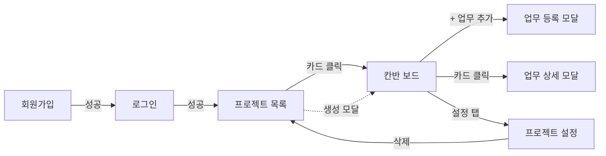

# 동잇 — UI 설계서 (MVP)

> 버전: v0.2 (결정 확정: 아이콘 SVG 직접 포함, 업무 번호 숨김, 설정 탭 전원 공개, 통계 탭 범위, 댓글 "수정됨") · v0.1 (초안) | 작성일: 2026-11-12 | 범위: **P0 화면만**
> 근거: REQUIREMENTS.md v0.8 §6·§7.2 → API-SPEC.md v0.4 → Figma `동잇` (컴포넌트 v0.2, 화면 6장)
> API 경로는 API-SPEC 표기대로 `/api` 접두어를 생략해 적는다(예: `GET /projects` = `GET /api/projects`).
> 문서끼리 다르면 REQUIREMENTS → API-SPEC → 이 문서 → Figma 순서로 따른다. Figma를 고칠 때는 이 문서를 먼저 고친다.

## 1. 원칙

1. **P0 게이트(11/19) 전에는 P0 화면만 구현한다.** Figma에 있는 P1 요소는 아래 §8 표에 따라 숨기거나 자리만 둔다.
2. P1 요소가 들어갈 **자리는 레이아웃에서 미리 정해 둔다.** P1 때 레이아웃을 다시 짜지 않는다.
3. 버튼 숨김·비활성은 편의 기능이다. 실제 권한은 백엔드 `require_project_role`이 막는다.
4. `dangerouslySetInnerHTML`은 쓰지 않는다. 사용자가 입력한 문자열(제목·설명·이름)은 그대로 텍스트로 렌더링한다.
5. 공통 컴포넌트는 `frontend/src/core/`에 둔다(스타터킷).

## 2. 화면 목록 (P0)

| # | 화면 | 주소 | 기능 ID | 스토리 | 담당 | Figma |
| :-: | --- | --- | --- | --- | --- | --- |
| S1 | 로그인 | `/login` | AUTH-02, 04 | US-02, 03 | FE-A | **없음 — 추가 필요** |
| S2 | 회원가입 | `/signup` | AUTH-01 | US-01 | FE-A | **없음 — 추가 필요** |
| S3 | 프로젝트 목록 (+ 생성 모달) | `/projects` | PRJ-01, 02 | US-05, 06 | FE-A | 빈 상태만 있음 |
| S4 | 칸반 보드 | `/projects/:id` | TASK-02, 05, PRJ-07 | US-12, 13 | FE-B | 칸반 |
| S5 | 업무 등록 모달 | 주소 없음 (S4 위) | TASK-01, 03, 04 | US-11 | FE-B | 새 업무 |
| S6 | 업무 상세 모달 | `/projects/:id/tasks/:taskId` | TASK-02, 03, 06 | US-13, 14 | FE-B | 업무 상세 |
| S7 | 프로젝트 설정 | `/projects/:id/settings` | PRJ-03, 04, 05, 07 | US-07, 08, 09 | FE-A | **없음 — 추가 필요** |
| S8 | 403 · 404 안내 | 공통 | NFR-09 | US-03 | FE-A | **없음 — 추가 필요** |

- `/` 접속 시 P0 기간에는 `/projects`로 보낸다(REQUIREMENTS §6). 내 대시보드(`/`)는 P1.
- 로그인하지 않은 상태로 S3~S7에 들어오면 `/login`으로 보낸다.

### 화면 흐름



## 3. 공통 레이아웃

### 3.1 TopBar (S3~S8)

| 영역 | P0 | P1 이후 |
| --- | --- | --- |
| 왼쪽 | 로고 `동잇` → `/projects` | — |
| 메뉴 | `프로젝트` 1개 | `내 대시보드` 추가 |
| 오른쪽 | 아바타 + 이름 ▾ → 메뉴: `로그아웃` | `내 정보 수정`(AUTH-06) 추가 |

### 3.2 ProjectHeader (S4, S7)

```
프로젝트 ›
백엔드 MVP   11.10 – 11.19   (지)(민)(서)(현)            [P1: 진행률 바 42% · 5/12 완료]
[보드] [설정]                                             [P1: 통계 탭은 보드와 설정 사이]
```

- 탭은 P0에서 `보드`·`설정` 2개. **설정 탭은 모든 멤버에게 보인다**(아래 S7 참고).
- 멤버 아바타 묶음은 최대 4개 + `+n`. 누르면 S7로 이동한다.
- 진행률 바(DASH-01)는 P1. P0에서는 그 자리를 비워 둔다.

## 4. 화면별 명세

### S1 로그인 · S2 회원가입

- 가운데 카드 1장. TopBar 없음.
- S1 필드: 아이디, 비밀번호. S2 필드: 아이디, 비밀번호, 이름.
- 입력 검증(프론트, 제출 시): 아이디 `^[a-z0-9]{4,20}$`(대문자는 입력 즉시 소문자로 바꿔 보여 줌), 비밀번호 8~64자, 이름 1~50자.
- 가입 성공 → 토스트 `가입했어요. 로그인해 주세요` → `/login`(자동 로그인 안 함).
- 로그인 성공 → 토큰을 localStorage에 저장 → `/projects`.
- 오류: 401 `INVALID_CREDENTIALS` → 폼 아래 `아이디 또는 비밀번호가 올바르지 않아요`, 409 `LOGIN_ID_ALREADY_EXISTS` → 아이디 필드 아래 `이미 사용 중인 아이디예요`.
- Axios 401 인터셉터(토큰 삭제 → `/login` 이동)는 `/auth/login` 요청에는 적용하지 않는다. 적용하면 로그인 실패 문구 대신 화면이 새로고침된다.
- API: `POST /auth/signup`, `POST /auth/login`, 앱 시작 시 `GET /users/me`.

### S3 프로젝트 목록

- 헤더: `내 프로젝트 n` + `+ 새 프로젝트`(Primary).
- 카드 그리드(데스크톱 3열 → 태블릿 2열 → 모바일 1열): 이름, 기간, 내 역할 배지. P1 진행률 바 자리는 비워 둔다.
- 생성 모달: 이름*(1~30자), 설명, 시작일, 종료일 → `만들기` 성공 시 새 프로젝트의 S4로 이동.
- 빈 상태: Figma `프로젝트가 0개일 때` 그대로.
- API: `GET /projects`, `POST /projects`.

### S4 칸반 보드

```
ProjectHeader
------------------------------------------------------------------ [+ 업무 추가]
[P1: 검색 · 담당자 · 우선순위 · 마감일 · 초기화]
| ● 할 일 4      | ● 진행 중 3     | ● 완료 5        |
| TaskCard ...   | TaskCard ...    | TaskCard ...    |
|                |                 | n개 더 보기 ▾   |
```

- 컬럼 3개 고정(`TODO`·`IN_PROGRESS`·`DONE`). 모바일 폭에서는 세로로 쌓는다.
- 데이터: 컬럼마다 `GET /projects/{id}/tasks?status=…&size=20` 1번씩. `n개 더 보기`는 다음 `page`를 불러와 이어 붙인다.
- 정렬은 서버 정렬을 그대로 쓴다(우선순위 → 마감일 → 마감 없음은 뒤 → id).
- `+ 업무 추가`는 **헤더 오른쪽 버튼 1개만** 둔다. 컬럼별 `+`는 없앤다(§8-1).
- 상태 변경: 카드의 StatusSelect → `PATCH /tasks/{id} {status}` 성공 → 바뀐 두 컬럼을 다시 조회 → 성공 토스트.
- 카드 본문 클릭 → S6 열기(주소 변경).
- 빈 컬럼: Figma `칸반 컬럼이 비었을 때` 그대로.

### S5 업무 등록 모달

- 부제: `'할 일' 칸에 추가됩니다`(API가 `status`를 받지 않고 항상 `TODO`로 만든다).
- 필드: 제목*(글자 수 `n/30` 표시), 설명, 우선순위(세그먼트 4칸, 기본 `보통`), 담당자(멤버만, 첫 항목 `담당자 없음`), 마감일(지난 날짜 허용, 안내 문구 표시).
- 제목이 비었거나 30자를 넘으면 `업무 추가` 버튼을 비활성화하고 필드 아래에 오류를 표시한다.
- 담당자 목록은 S4에서 받은 멤버 목록을 재사용한다(`GET /projects/{id}/members`).
- 400 `ASSIGNEE_NOT_MEMBER`(그 사이 멤버가 제거됨) → 담당자 필드 오류 + 멤버 목록 다시 조회.
- API: `POST /projects/{id}/tasks`.

### S6 업무 상세 모달

```
백엔드 MVP › 업무 상세                              [링크 복사] [삭제] [✕]
-------------------------------------------------------------------------
제목 (클릭해서 수정)                      | 속성
설명 (클릭해서 수정)                      | 상태      StatusSelect
                                          | 우선순위  PrioritySelect
[P1: 댓글 n | 변경 이력 n 탭]             | 담당자    MemberSelect
                                          | 마감일    DatePicker + DueLabel
                                          | 작성자 / 만든 날 (읽기 전용)
```

- 속성(오른쪽)은 **고르는 즉시 저장**한다. 바꾼 필드 1개만 `PATCH`로 보낸다 → 이력도 1행.
- 제목·설명은 눌러서 수정 → `저장`/`취소`. 이 두 필드는 이력 대상이 아니다(LOG-01).
- 삭제 → ConfirmDialog(`변경 이력은 남습니다`) → `DELETE /tasks/{id}` → 모달 닫고 보드 다시 조회.
- `링크 복사`는 현재 주소를 클립보드에 복사한다(서버 호출 없음).
- 댓글·변경 이력 탭(CMT-01·02, LOG-03)은 P1. P0에서는 왼쪽 아래를 비워 둔다.

권한별 화면 상태 (TASK-06, API-SPEC §5 PATCH 권한표):

| 보는 사람 | 제목·설명 | 상태 | 우선순위·담당자·마감일 | 삭제 버튼 |
| --- | :-: | :-: | :-: | :-: |
| OWNER | 수정 | 수정 | 수정 | 보임 |
| MEMBER + 작성자 | 수정 | 수정 | 수정 | 보임 |
| MEMBER + 담당자(작성자 아님) | 읽기 | 수정 | 🔒 읽기 | 숨김 |
| 그 외 MEMBER | 읽기 | 🔒 읽기 | 🔒 읽기 | 숨김 |

### S7 프로젝트 설정

한 페이지에 세 구역을 둔다. 하위 주소나 탭은 만들지 않는다.

| 구역 | OWNER | MEMBER |
| --- | --- | --- |
| 프로젝트 정보 (이름·설명·기간) | 수정 + `저장` | 읽기 전용 |
| 멤버 (이름·아이디·역할) | 아이디 입력 + 역할 선택 + `추가`, 행마다 `제거` | **목록만** (PRJ-07) |
| 프로젝트 삭제 | 확인 창에서 프로젝트 이름을 입력해야 `삭제` 활성 | 구역 숨김 |

- 멤버 제거 확인 창: `○○님이 담당하던 업무는 담당자 없음이 돼요`(PRJ-05).
- 오류: 400 `LAST_OWNER` → 토스트 `OWNER는 최소 1명 있어야 해요`, 404 `USER_NOT_FOUND` → 입력 필드 아래 `가입하지 않은 아이디예요`, 409 `ALREADY_MEMBER` → 입력 필드 아래 `이미 멤버예요`.
- API: `GET·PATCH·DELETE /projects/{id}`, `GET·POST /projects/{id}/members`, `DELETE /projects/{id}/members/{user_id}`.

### S8 403 · 404 안내

- ErrorPage 컴포넌트 1개에 문구만 바꿔 쓴다. TopBar 유지, 버튼 `프로젝트 목록으로`.
- 403 `NOT_PROJECT_MEMBER`(페이지 진입) → 안내 화면. 403 `FORBIDDEN`(버튼 동작) → 에러 토스트만 띄우고 화면은 유지한다.

## 5. 공통 컴포넌트 (Figma 컴포넌트 v0.2 기준)

| 컴포넌트 | 위치 | P0 사용처 | 비고 |
| --- | --- | --- | --- |
| Icon (16px) | `core/ui/icons` | 전체 | lucide SVG(ISC 라이선스)를 쓰는 것만 복사해 컴포넌트로 감싼다. 아이콘 라이브러리는 추가하지 않는다 |
| Avatar | `core/ui` | TopBar, 카드, 멤버 | 이름 첫 글자 + 사용자별 고정 색. 담당자 없음은 `?` 회색 |
| PriorityBadge | `core/ui` | 카드, 상세 | §6.1 |
| StatusSelect | `core/ui` | 카드, 상세 | 권한 없으면 🔒 + 읽기 전용 |
| DueLabel | `core/ui` | 카드, 상세 | §6.3 |
| Button | `core/ui` | 전체 | Primary · Secondary · Ghost · Danger |
| Modal / ConfirmDialog | `core/ui` | S3, S5, S6, S7 | ESC·바깥 클릭으로 닫기 (입력 중이면 확인) |
| Toast | `core/ui` | 전체 | 성공 · 오류 · 세션 만료. 화면 아래 가운데, 3초 후 사라짐 |
| EmptyState | `core/ui` | S3, S4 | 아이콘 + 제목 + 설명 + 버튼(선택) |
| Skeleton | `core/ui` | S3, S4, S6 | 불러오는 중 |
| TopBar | `core/layout` | S3~S8 | §3.1 |
| ProjectHeader | `features/project` | S4, S7 | §3.2 |
| TaskCard | `features/task` | S4 | 우선순위 · DueLabel · 제목 · 담당자 · StatusSelect |
| TaskForm | `features/task` | S5 | |
| MemberSelect | `features/project` | S5, S6 | `담당자 없음` + 멤버(이름·아이디) |
| ProtectedRoute | `core/auth` | 라우터 | 토큰 없으면 `/login` |

## 6. 표시 규칙

### 6.1 우선순위

| 값 | 화면 표기 | 색 |
| --- | --- | --- |
| `URGENT` | 긴급 | 빨강 |
| `HIGH` | 높음 | 주황 |
| `MEDIUM` | 보통 (기본값) | 파랑 |
| `LOW` | 낮음 | 회색 |

### 6.2 상태

| 값 | 화면 표기 | 점 색 | 카드 |
| --- | --- | --- | --- |
| `TODO` | 할 일 | 회색 | 기본 |
| `IN_PROGRESS` | 진행 중 | 파랑 | 기본 |
| `DONE` | 완료 | 초록 | 제목 취소선 · 마감 표시 숨김 |

### 6.3 마감 표시 (DueLabel)

"오늘"은 한국 날짜다(API-SPEC §1.6). 브라우저 시간대가 아니라 한국 날짜 기준으로 계산한다. 완료된 업무에는 표시하지 않는다.

| 조건 | 표기 | 스타일 |
| --- | --- | --- |
| 마감일 < 오늘 | `n일 지남` | 빨강 배지 + 경고 아이콘 |
| 마감일 = 오늘 | `오늘 마감` | 주황 배지 + 시계 아이콘 |
| 마감일 = 내일 | `내일 마감` | 주황 배지 |
| 오늘 + 2 ~ 3일 | `D-2`, `D-3` | 주황 배지 |
| 그 이후 | `11/20` | 회색 글자 |
| 없음 | `마감 없음` | 연회색 글자 |

> 임박 범위(오늘 ~ +3일)는 DASH-03 정의와 같다. 카드 표시는 P0, 임박·지연 목록 화면은 P1.

### 6.4 날짜 · 시간

- 프로젝트 기간: `11.10 – 11.19`. 마감일: `11/14`, 입력창 `2026-11-14 (토)`.
- 서버 시각(UTC `Z`)은 화면에서 한국 시간으로 바꿔 `오늘 09:41`, `어제 18:22`, `11/10 14:20`으로 표시한다.

### 6.5 문구

- 말투는 `~해요`체로 통일한다(Figma 기준).
- API 오류는 `code`로 문구를 고른다. 모르는 `code`는 서버 `message`를 그대로 보여 준다.
- 401 → 토큰 삭제 → 토스트 `로그인이 만료됐어요. 다시 로그인해 주세요` → `/login`.

## 7. 디자인 토큰

Figma `동잇 Colors` 변수를 Tailwind 4의 CSS `@theme`(예: `src/index.css`의 `--color-primary`)로 옮긴다(ARCHITECTURE §2). 아래 값은 화면에서 읽은 추정값이고, **확정 값은 Figma 변수에서 가져온다.**

| 토큰 | 용도 | 추정값 |
| --- | --- | --- |
| `primary` | 주 버튼, 선택 탭, 진행 중 | `#2F5BEA` |
| `danger` | 긴급, 지연, 삭제 | `#E5484D` |
| `warning` | 높음, 임박 | `#F76808` |
| `info` | 보통 | `#3E7BFA` |
| `success` | 완료 | `#12B886` |
| `neutral-50~900` | 배경, 컬럼, 테두리, 글자 | Figma 값 |

- 모서리: 카드·입력 8px, 모달 12px, 배지 4px. 간격은 4px 배수.
- 글꼴: Figma 지정 글꼴(확인 필요). 기본 14px, 카드 제목 15px 굵게, 페이지 제목 24px.

## 8. Figma와 MVP 차이 — 조정 사항

| # | Figma | 문제 | MVP 처리 |
| :-: | --- | --- | --- |
| 1 | 컬럼마다 `+` 버튼 | API가 `status`를 받지 않아 항상 `TODO`로 생성됨. 진행 중·완료 컬럼의 `+`는 동작과 맞지 않음 | 컬럼 `+` 제거, 헤더 `+ 업무 추가` 1개 |
| 2 | TopBar `내 대시보드` | DASH-04 (P1) | P0에서는 메뉴 숨김 |
| 3 | 탭 `통계` 화면 | DASH-01·02·03, LOG-03 (P1) | P0에서는 탭 숨김. 화면 설계는 P1용으로 보존 |
| 4 | 진행률 바 | DASH-01 (P1) | 자리만 비워 둠 |
| 5 | 검색·필터 바 | TASK-07 (P1) | 숨김. `검색 결과 없음` 빈 상태도 P1 |
| 6 | 상세 모달 댓글·변경 이력 탭 | CMT-01·02, LOG-03 (P1) | 자리만 비워 둠. 이력 **기록**은 P0(백엔드) |
| 7 | 토스트 `되돌리기` | 명세에 없는 기능. 되돌리면 이력이 1행 더 생김 | P0에서는 제거. 원하면 P2 아이디어로 등록 |
| 8 | 로그인·회원가입·목록·설정·403/404 프레임 없음 | P0 화면 4종이 디자인되지 않음 | Figma에 추가 필요 (§2) |
| 9 | 아이콘 `lucide` | 기술 스택에 아이콘 라이브러리가 없음 | 쓰는 SVG만 `core/ui/icons`에 복사 |
| 10 | 상세 모달 `#27` | `tasks.id`는 전체 공통 번호라 프로젝트마다 1부터 시작하지 않음 | 표시하지 않음. 브레드크럼은 `프로젝트명 › 업무 상세` |

Figma에서 그대로 쓰는 것: 카드 구성, 권한별 🔒 표시, 속성 즉시 저장, 새 업무 모달의 검증·안내 문구, 빈 상태·스켈레톤·삭제 확인 창.

## 9. 결정 기록 (2026-11-12 확정)

| # | 항목 | 결정 | 반영 위치 |
| :-: | --- | --- | --- |
| 1 | 아이콘 | lucide SVG를 `core/ui/icons`에 직접 넣음. 라이브러리 추가 없음 | §5 |
| 2 | MEMBER의 멤버 목록 위치 | 설정 탭을 모두에게 보여 주고 MEMBER는 읽기 전용 | §3.2, S7, REQUIREMENTS §6 |
| 3 | 업무 번호(`#27`) | 표시하지 않음 | S6, §8-10 |
| 4 | 통계 탭 범위(P1) | 진행률 · 담당자별 현황(DASH-02) · 마감 임박·지연(DASH-03) · 최근 활동 20건(LOG-03) | REQUIREMENTS §6 |
| 5 | "오늘" 기준 | 한국 날짜 | §6.3, API-SPEC §1.6 |
| 6 | 댓글 수정 표시(P1) | `updated_at`이 `created_at`과 다르면 작성 시각 옆에 `수정됨` | REQUIREMENTS CMT-02 |
