# 동잇 사용자 매뉴얼

> 프로젝트: 동잇(Doing_It) — 팀 협업 프로젝트 관리 시스템 | 작성: 김서현 (D11-04) | 작성일: 2026-11-25 | 기준: 기능 동결(M3, 11/24) 뒤 main
> 스크린샷: 11/25 main에서 매뉴얼용 데이터(이지수·김민호·박서연·최현우, 프로젝트 "동잇 개발")로 찍었다. 아이디 끝의 숫자(`minho629` 등)는 매뉴얼용 계정이라 붙은 것이다.
> 대상: 동잇을 처음 쓰는 팀원. 설치·실행 방법은 [README.md](../README.md)를, 기능의 정확한 규칙은 [SPEC.md](./SPEC.md)·[UI-DESIGN.md](./UI-DESIGN.md)를 따른다. 이 문서와 명세가 다르면 명세가 맞다.

## 목차

1. [시작하기](#1-시작하기)
2. [역할과 권한](#2-역할과-권한)
3. [회원가입·로그인·내 정보](#3-회원가입로그인내-정보)
4. [내 대시보드](#4-내-대시보드)
5. [프로젝트 목록·만들기](#5-프로젝트-목록만들기)
6. [칸반 보드](#6-칸반-보드)
7. [업무 상세](#7-업무-상세)
8. [간트](#8-간트)
9. [통계](#9-통계)
10. [프로젝트 설정·멤버](#10-프로젝트-설정멤버)
11. [화면 표시 규칙](#11-화면-표시-규칙)
12. [안내 화면과 문제 해결](#12-안내-화면과-문제-해결)

---

## 1. 시작하기

### 1.1 접속

- 주소: 배포 환경은 **`https://doing-it.netlify.app`**, 개발·발표 시연 환경은 `http://localhost:5173` (실행 방법은 README).
- 권장 브라우저: Chrome, Edge 최신 버전(11/24 점검). 창 폭 375px(휴대폰)부터 1920px까지 쓸 수 있다.
- 처음이면 **회원가입** → **로그인** 순서로 들어간다.

### 1.2 시연 계정

시연 데이터(seed)를 넣으면 아래 계정과 프로젝트 "동잇 개발"(업무 12개)이 생긴다. 비밀번호는 모두 `password123`이다. **공개된 비밀번호라 원칙적으로 로컬 시연 전용이다.** 예외로 11/26 발표용 배포 환경에도 같은 계정이 있으며, 누구나 로그인할 수 있으므로 발표 후 내리거나 비밀번호를 바꾼다(ARCHITECTURE §9.1).

| 아이디 | 이름 | "동잇 개발"에서의 역할 |
| --- | --- | --- |
| `jisoo01` | 이지수 | OWNER |
| `minho` | 김민호 | MEMBER |
| `seoyeon` | 박서연 | MEMBER |
| `hyunwoo` | 최현우 | MEMBER |

### 1.3 화면 한눈에 보기

| 화면 | 주소 | 하는 일 |
| --- | --- | --- |
| 로그인 / 회원가입 | `/login`, `/signup` | 계정 만들기, 들어가기 |
| 내 대시보드 | `/` | 내 마감 달력 + 내가 맡은 미완료 업무 |
| 프로젝트 목록 | `/projects` | 내가 속한 프로젝트, 새 프로젝트 만들기 |
| 칸반 보드 | `/projects/:id` | 업무 추가, 상태 바꾸기, 검색·필터 |
| 업무 상세 | `/projects/:id/tasks/:taskId` | 업무 수정, 댓글, 변경 이력 |
| 간트 | `/projects/:id/gantt` | 업무 기간을 막대로 보기 |
| 통계 | `/projects/:id/stats` | 진행률, 담당자별 현황, 마감 임박·지연, 최근 활동 |
| 설정 | `/projects/:id/settings` | 프로젝트 정보, 멤버, 삭제 |

화면 위쪽 막대(TopBar)에서 언제든 **프로젝트** · **내 대시보드**로 이동하고, 오른쪽 이름을 누르면 **내 정보 수정** · **로그아웃**이 나온다. 프로젝트 안에서는 이름 아래 탭 **보드 · 간트 · 통계 · 설정**으로 옮겨 다닌다.

---

## 2. 역할과 권한

프로젝트마다 역할이 있다. 만든 사람은 **OWNER**, 추가된 사람은 추가할 때 정한 역할(기본 **MEMBER**)이 된다.

| 할 수 있는 일 | OWNER | MEMBER |
| --- | :-: | :-: |
| 프로젝트·업무·멤버 목록 보기, 통계·간트 보기 | ✅ | ✅ |
| 업무 만들기, 댓글 쓰기 | ✅ | ✅ |
| 프로젝트 정보 수정·삭제 | ✅ | — |
| 멤버 추가·제거·역할 변경 | ✅ | — |

업무는 역할과 함께 **작성자(만든 사람)·담당자**인지에 따라 달라진다.

| 보는 사람 | 제목·설명 | 상태 | 우선순위·담당자·마감일 | 삭제 |
| --- | :-: | :-: | :-: | :-: |
| OWNER | 수정 | 수정 | 수정 | 가능 |
| 작성자(MEMBER) | 수정 | 수정 | 수정 | 가능 |
| 담당자(작성자 아님) | 읽기 | 수정 | 🔒 읽기 | — |
| 그 외 MEMBER | 읽기 | 🔒 읽기 | 🔒 읽기 | — |

- 🔒는 바꿀 수 없다는 표시다. 화면에서 버튼을 숨기는 것과 별개로 **서버도 같은 규칙으로 거절**한다.
- 댓글은 **쓴 사람만** 고치고 지울 수 있다(OWNER도 남의 댓글은 못 고친다).
- 프로젝트 멤버가 아니면 그 프로젝트의 어떤 화면도 볼 수 없다(이름조차 보이지 않는다).

---

## 3. 회원가입·로그인·내 정보

### 3.1 회원가입 (`/signup`)

| 칸 | 규칙 |
| --- | --- |
| 아이디 | 영문 소문자·숫자 4~20자. 이미 있는 아이디는 대소문자가 달라도 쓸 수 없다("이미 사용 중인 아이디입니다") |
| 비밀번호 | 8~64자(한글은 24자까지). 눈 모양 버튼으로 보이기·숨기기 |
| 이름 | 앞뒤 공백을 빼고 1~50자. 팀원에게 보이는 이름 |

- 칸을 잘못 채우면 그 칸 아래에 이유가 빨간 글씨로 나온다.
- 가입이 끝나면 "가입되었습니다. 로그인해 주세요" 안내와 함께 로그인 화면으로 간다(자동 로그인은 하지 않는다).

### 3.2 로그인 (`/login`)

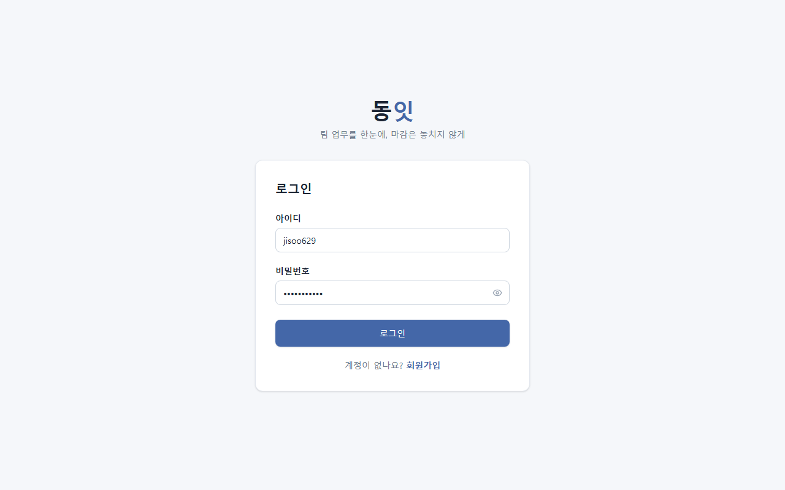

- 아이디·비밀번호를 넣고 **로그인** → **내 대시보드**로 들어간다.
- 틀리면 "아이디 또는 비밀번호가 올바르지 않습니다" 한 가지만 나온다(아이디가 있는지 알려 주지 않기 위해서다).
- 사용이 막힌 계정은 "사용할 수 없는 계정입니다".
- 로그인은 **2시간** 유지된다. 새로고침해도 그대로다. 2시간이 지나 무언가를 누르면 "로그인이 만료되었습니다. 다시 로그인해 주세요"와 함께 로그인 화면으로 간다.

### 3.3 내 정보 수정 · 로그아웃

- TopBar 오른쪽 이름 → **내 정보 수정**: 이름(1~50자)만 바꿀 수 있다. **저장**하면 "이름을 바꿨습니다"가 뜨고, 보고 있던 화면의 담당자·댓글 작성자·멤버 목록까지 바로 새 이름으로 바뀐다.
- **로그아웃**: 로그인 화면으로 간다. 뒤로 가기를 눌러도 이전 화면은 보이지 않는다.

---

## 4. 내 대시보드 (`/`)

로그인하면 처음 보이는 화면이다. **여러 프로젝트를 돌아다니지 않고 내 할 일부터** 확인한다.

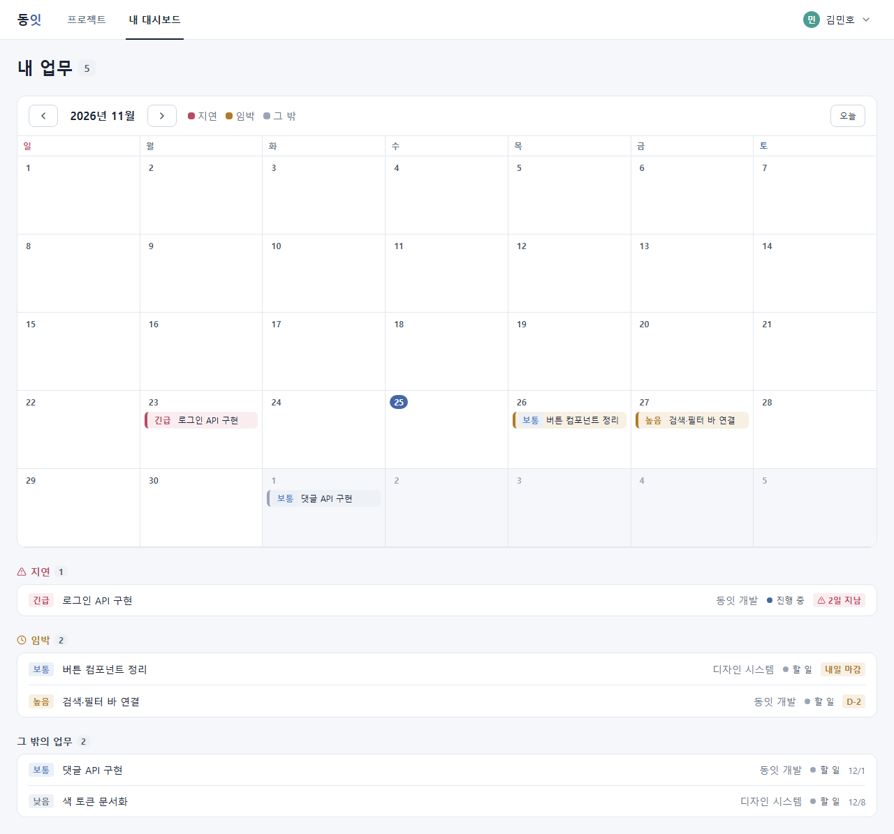

### 4.1 마감일 달력 (위쪽)

- 나에게 맡겨진 **미완료** 업무를 마감일 칸에 우선순위 배지와 함께 보여 준다. 완료한 업무와 마감일 없는 업무는 달력에 나오지 않는다.
- **‹** **›**로 이전·다음 달, **오늘**로 이번 달로 돌아온다. 오늘 칸은 따로 표시된다.
- 한 칸에 업무가 많으면 2개만 보이고 **+n개 더**를 누르면 펼쳐진다(**접기**로 다시 접음).
- 업무에 마우스를 올리면 프로젝트 이름이 보이고, 누르면 업무 상세가 열린다.

### 4.2 내 업무 목록 (아래쪽)

- 나에게 맡겨진 미완료 업무를 **지연 → 임박 → 그 밖의 업무** 순으로 묶어 보여 준다. 각 묶음 안에서는 마감일 빠른 순(마감일 없는 업무는 맨 뒤)이다.
- 행마다 우선순위, 제목, **프로젝트 이름**, 상태, 마감 표시가 있다. 누르면 업무 상세로 간다.
- 맡은 업무가 없으면 "할당된 업무가 없습니다"와 **프로젝트로 가기** 버튼이 보인다.

---

## 5. 프로젝트 목록·만들기 (`/projects`)

- 내가 속한 프로젝트만 카드로 보인다. 카드에는 이름, 설명(2줄까지), 기간, **내 역할**, 진행률이 있다. 카드를 누르면 칸반 보드로 간다.
- 프로젝트가 하나도 없으면 "프로젝트를 만들어 보세요"와 **첫 프로젝트 만들기** 버튼이 보인다.

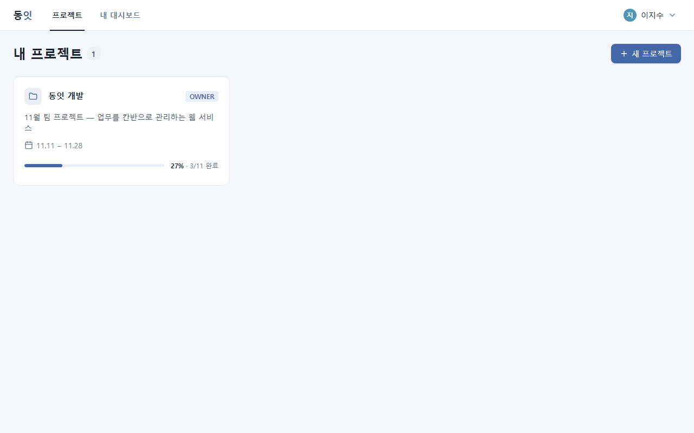

### 새 프로젝트 만들기

**+ 새 프로젝트**(또는 **첫 프로젝트 만들기**)를 누르면 창이 열린다. 만든 사람이 OWNER가 된다.

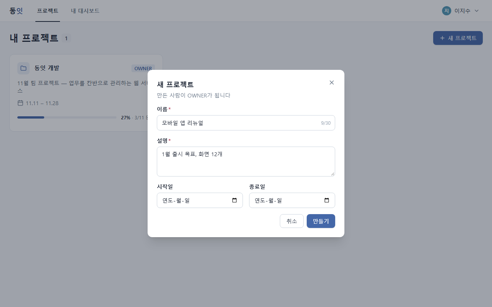

| 칸 | 규칙 |
| --- | --- |
| 이름* | 1~30자. 칸 오른쪽에 `n/30`이 보이고, 넘으면 "프로젝트 이름은 1~30자로 입력해 주세요" |
| 설명* | 필수(앞뒤 공백만 있으면 안 됨). 비어 있으면 "프로젝트 설명을 입력해 주세요" |
| 시작일·종료일 | 선택. 종료일이 시작일보다 앞이면 "종료일은 시작일 이후여야 합니다" |

조건을 모두 채워야 **만들기**가 켜진다. 만들면 "프로젝트를 만들었습니다"와 함께 새 프로젝트의 칸반 보드로 간다.

---

## 6. 칸반 보드 (`/projects/:id`)

위쪽에 프로젝트 이름·기간·멤버 아바타·**진행률**(완료 업무 / 전체 업무)이 있고, 아래에 **할 일 · 진행 중 · 완료** 3개 컬럼이 있다. 휴대폰 폭에서는 컬럼이 세로로 쌓인다.

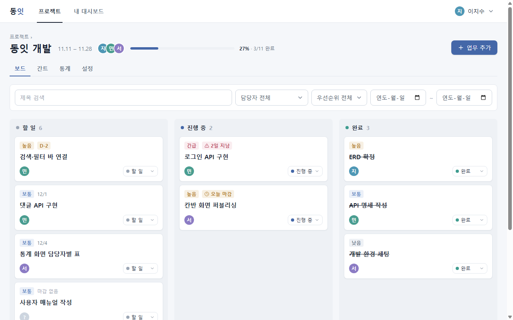

### 6.1 업무 추가

오른쪽 위 **+ 업무 추가** → "새 업무" 창. 새 업무는 항상 **할 일** 칸에 들어간다.

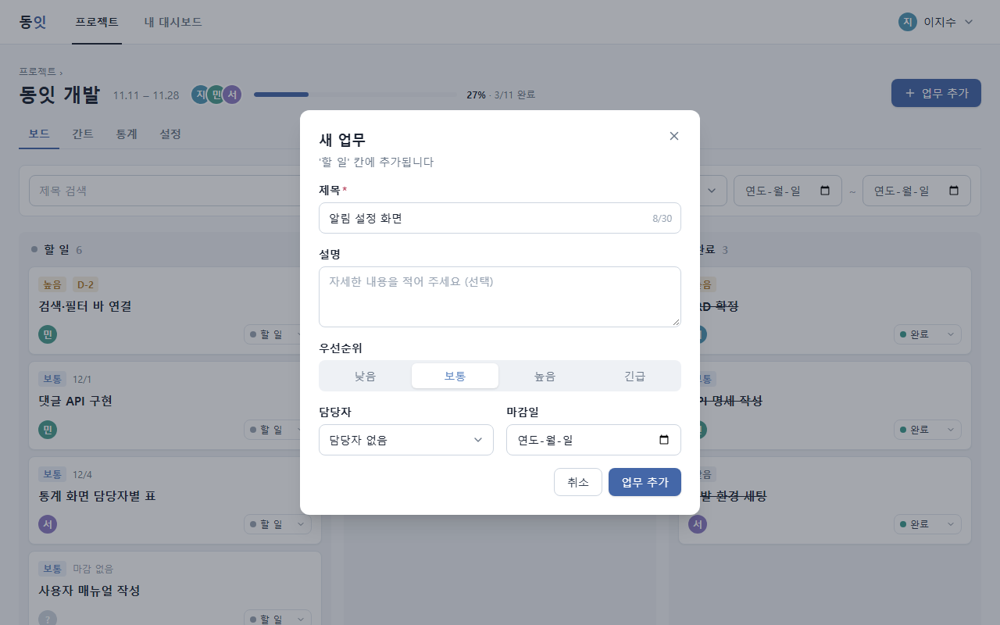

| 칸 | 규칙 |
| --- | --- |
| 제목* | 1~30자(`n/30`). 넘으면 "업무 제목은 1~30자로 입력해 주세요" |
| 설명 | 선택, 2000자까지 |
| 우선순위 | 낮음·보통·높음·긴급 (기본 보통) |
| 담당자 | 이 프로젝트 멤버 중 한 명, 또는 담당자 없음 |
| 마감일 | 선택. 지난 날짜도 넣을 수 있다("지난 날짜입니다. 지연 업무로 표시됩니다") |

### 6.2 카드 읽기

카드에는 **우선순위 배지**, **마감 표시**(11장 참고), 제목, 담당자 아바타(없으면 `?`), 상태 선택이 있다. 완료 카드는 제목에 취소선이 그어진다. 카드 제목을 누르면 업무 상세가 열린다.

### 6.3 상태 바꾸기

- **드롭다운:** 카드의 상태(● 할 일 ▾)를 눌러 다른 상태를 고른다.
- **드래그 앤 드롭:** 카드를 다른 컬럼으로 끌어다 놓는다. 놓을 수 있는 컬럼은 테두리가 강조된다. 같은 컬럼에 놓으면 아무 일도 없다. (마우스 전용 — 휴대폰에서는 드롭다운을 쓴다)
- 바뀌면 "상태를 '진행 중'으로 변경했습니다"처럼 알려 주고, 변경 이력에 남는다.
- 상태를 바꿀 권한이 없는 카드는 🔒로 보이고 끌리지도 않는다. 그 사이 권한이 없어졌다면 "상태를 바꿀 권한이 없습니다"가 뜨고 카드는 제자리에 남는다.

### 6.4 검색·필터

컬럼 위 막대에서 조건을 고르면 바로 걸러진다. 여러 조건은 **모두 만족**하는 업무만 보인다.

| 조건 | 설명 |
| --- | --- |
| 제목 검색 | 제목에 들어간 글자로 찾기(입력을 멈추면 0.3초 뒤 반영) |
| 담당자 | 멤버 한 명, 또는 **담당자 없음** |
| 우선순위 | 긴급·높음·보통·낮음 |
| 마감일 | 시작 ~ 끝 날짜 범위 |

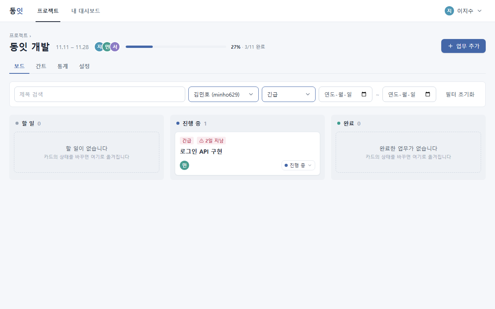

- 조건은 **주소에 남는다.** 주소를 복사해 팀원에게 보내면 같은 결과가 보이고, 새로고침해도 유지된다.
- 맞는 업무가 없으면 "조건에 맞는 업무가 없습니다"와 **필터 초기화**가 보인다.

### 6.5 업무가 많을 때

컬럼마다 20개씩 보이고, 더 있으면 아래 **n개 더 보기**로 이어서 불러온다.

### 6.6 휴대폰에서

컬럼이 세로로 쌓이고, 검색·필터 칸도 줄을 바꿔 정리된다. 상태는 카드의 드롭다운으로 바꾼다.

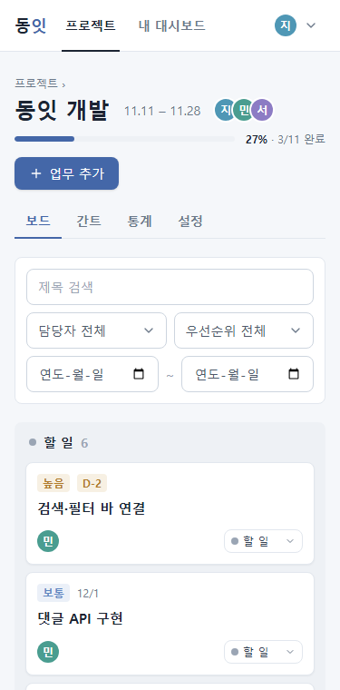

---

## 7. 업무 상세 (`/projects/:id/tasks/:taskId`)

카드(또는 간트 막대, 대시보드 업무)를 누르면 보드 위에 창으로 열린다. 이 주소를 그대로 공유하면 받은 사람도 같은 창을 본다.

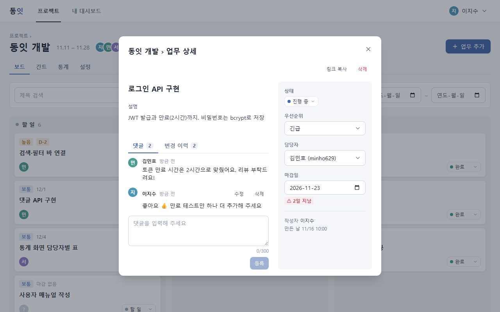

- **오른쪽 속성**(상태·우선순위·담당자·마감일): 고르는 **즉시 저장**된다("저장했습니다").
- **제목·설명**: 눌러서 고친 뒤 **저장**/**취소**.
- 아래쪽에 **작성자**와 **만든 날**이 보인다.
- 위쪽 **링크 복사**: 이 업무 주소를 복사한다. **삭제**: OWNER와 작성자에게만 보이며, 한 번 더 확인한 뒤 지운다(변경 이력은 남는다).
- 고치던 내용이 있는데 닫으려 하면 "작성 중인 내용이 사라집니다. 닫으시겠습니까?"라고 묻는다. 창은 ✕나 ESC로 닫는다(바깥을 눌러도 닫히지 않는다).

### 7.1 댓글 탭

- 아래쪽 **댓글** 탭에서 업무에 질문·메모를 남긴다(1~300자, `n/300`). 오래된 댓글이 위다.
- 내 댓글에만 **수정**·**삭제**가 보인다. 고친 댓글에는 "수정됨"이 붙는다.

### 7.2 변경 이력 탭

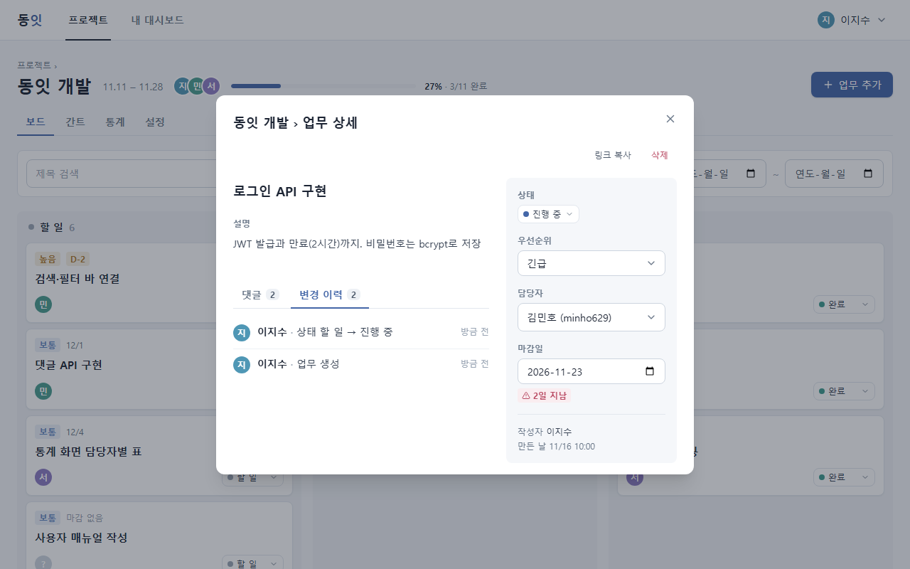

- **변경 이력** 탭에 이 업무의 **상태·담당자·마감일·우선순위** 변경이 최신순으로 쌓인다. 예: "김민호 · 마감일 11/20 → 11/25 · 방금 전".
- 업무를 만든 기록(업무 생성)도 남는다. 제목·설명과 댓글은 이력에 남지 않는다.
- 이력은 자동으로 기록되며 아무도 고치거나 지울 수 없다.

---

## 8. 간트 (`/projects/:id/gantt`)

탭 **간트**에서 업무가 언제 시작해 언제 끝나는지 가로 막대로 본다. 일정이 겹치는 때와 늦어지는 업무를 찾을 때 쓴다.

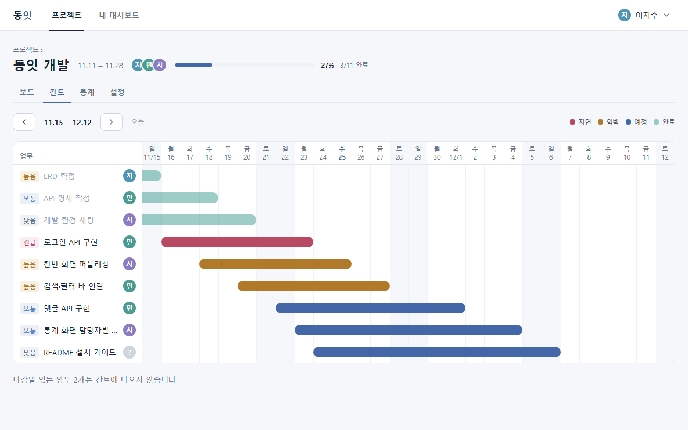

- 막대는 업무를 **만든 날부터 마감일까지**다. 마감일이 만든 날보다 앞인 업무(지난 날짜로 등록)는 마감일 하루짜리 막대로 보인다.
- 막대 색: **지연**(빨강) · **임박**(주황) · **예정**(파랑) · **완료**(흐린 초록). 색 기준은 보드의 마감 표시와 같다.
- 날짜 축은 4주이고, **‹** **›**로 1주씩 옮기며 **오늘**로 돌아온다. 오늘 날짜에는 세로선이 있다.
- 보이는 4주 밖에 있는 업무는 막대 대신 "‹ 11/10 마감", "1/3 시작 ›"처럼 방향을 알려 준다.
- 막대나 왼쪽 제목을 누르면 업무 상세가 간트 위에 열리고, 닫으면 보던 간트로 돌아온다.
- 마감일 없는 업무는 막대로 그리지 않고 표 아래에 "마감일 없는 업무 n개는 간트에 나오지 않습니다"로 알려 준다.
- 좁은 화면에서는 왼쪽 업무 칸은 고정되고 날짜 축만 옆으로 밀어 본다.

---

## 9. 통계 (`/projects/:id/stats`)

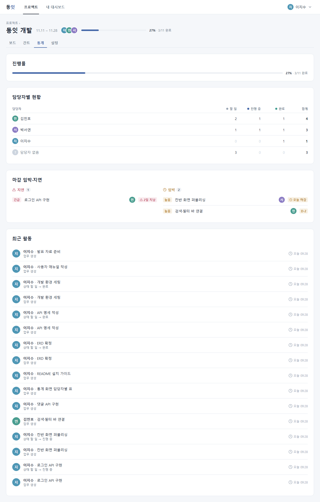

| 구역 | 내용 |
| --- | --- |
| 진행률 | 완료 업무 / 전체 업무 (예: 40% · 4/10 완료). 업무가 없으면 0% |
| 담당자별 현황 | 담당자 × 상태(할 일·진행 중·완료·합계) 표. 업무가 0건인 멤버도 0으로 보이고, **담당자 없음**은 맨 아래에 따로 센다 |
| 마감 임박·지연 | **지연**(마감일이 어제 이전) · **임박**(오늘 ~ 오늘+3일) 미완료 업무 목록 |
| 최근 활동 | 프로젝트 전체 변경 이력 최신 20건. 누르면 업무 상세(삭제된 업무는 회색, 눌리지 않음) |

---

## 10. 프로젝트 설정·멤버 (`/projects/:id/settings`)

설정 탭은 모든 멤버가 볼 수 있다. **MEMBER에게는 읽기 전용**으로 보이고, 아래 기능은 OWNER에게만 보인다.

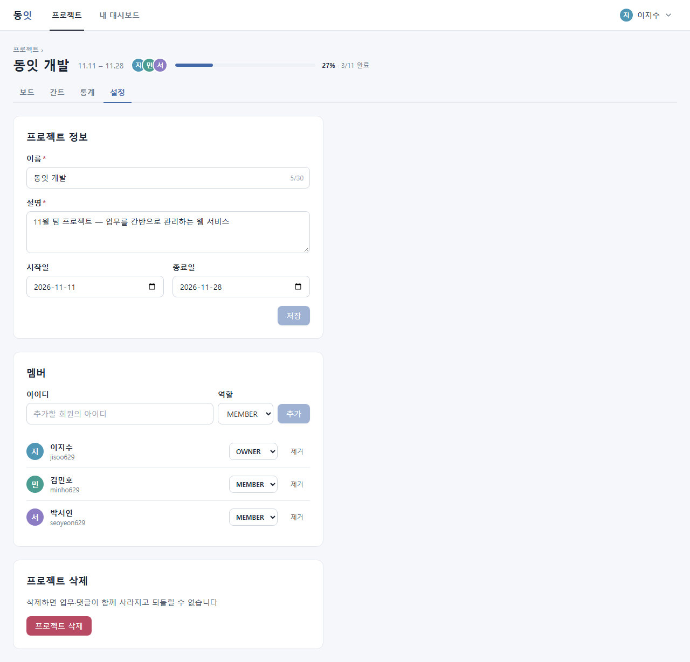

### 10.1 프로젝트 정보

이름·설명·기간을 고치고 **저장**("프로젝트 정보를 저장했습니다"). 규칙은 만들 때와 같다(설명은 비울 수 없다).

### 10.2 멤버

- **추가:** 아이디와 역할(MEMBER/OWNER)을 넣고 **추가**. 추가된 사람의 프로젝트 목록에 바로 나타난다.
  - 없는 아이디: "해당 아이디의 회원이 없습니다" · 이미 멤버: "이미 프로젝트 멤버입니다"
- **역할 변경:** 멤버 줄의 역할을 고르면 바로 바뀐다("○○님의 역할을 OWNER로 바꿨습니다"). 내 역할을 MEMBER로 내릴 때는 한 번 더 묻는다.
- **제거:** 멤버 줄의 **제거** → 확인. 그 사람이 맡던 업무는 **담당자 없음**이 되고, 그 사람 목록에서 프로젝트가 사라진다.
- **OWNER는 최소 1명** 있어야 한다. 마지막 OWNER는 제거하거나 MEMBER로 내릴 수 없다("OWNER는 최소 1명 있어야 합니다"). 넘기려면 다른 멤버를 먼저 OWNER로 바꾼다.

### 10.3 프로젝트 삭제

**프로젝트 삭제** → 확인 창에 **프로젝트 이름을 똑같이 입력**해야 삭제 버튼이 켜진다. 업무·댓글이 함께 지워지고 **되돌릴 수 없다.** 모든 멤버의 목록에서 사라진다.

---

## 11. 화면 표시 규칙

### 11.1 우선순위

| 배지 | 뜻 |
| --- | --- |
| 긴급 (빨강) | 가장 먼저 |
| 높음 (주황) | |
| 보통 (파랑) | 기본값 |
| 낮음 (회색) | |

칸반 컬럼 안은 **우선순위 → 마감일 빠른 순**(마감일 없음은 뒤)으로 정렬된다.

### 11.2 마감 표시

| 표시 | 뜻 |
| --- | --- |
| ⚠ n일 지남 (빨강) | **지연** — 마감일이 지났는데 미완료 |
| ◷ 오늘 마감 · 내일 마감 · D-2 · D-3 (주황) | **임박** — 오늘 ~ 3일 뒤 |
| 11/28 (회색) | 4일 이상 남음 |
| 마감 없음 | 마감일을 넣지 않음 |

- **"오늘"은 한국 날짜(UTC+9)** 기준이다. 해외 시간대 PC에서도 같은 결과가 나온다.
- 완료한 업무는 지연·임박으로 치지 않는다.

### 11.3 시각

방금(1분 안) 일은 "방금 전", 오늘은 "오늘 09:41", 어제는 "어제 18:22", 그 전은 "11/10 14:20"으로 보인다.

---

## 12. 안내 화면과 문제 해결

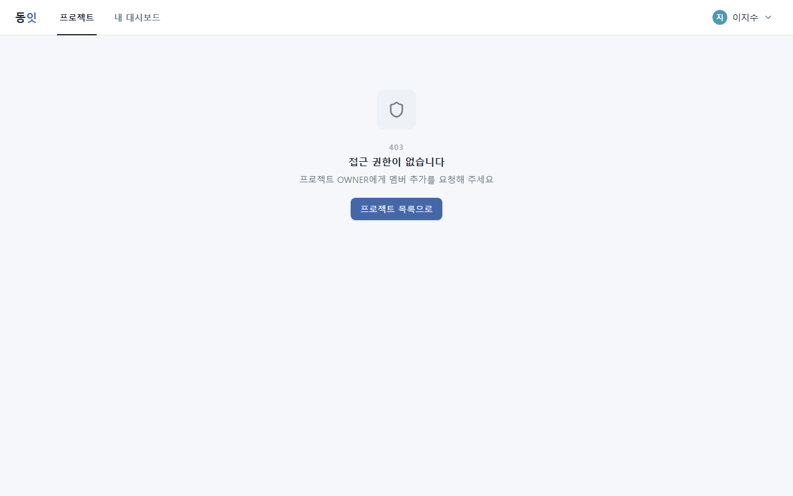

| 이런 화면이 보이면 | 이유 | 할 일 |
| --- | --- | --- |
| **403 접근 권한이 없습니다** | 그 프로젝트의 멤버가 아니다 | 프로젝트 OWNER에게 멤버 추가를 요청한다 |
| **404 페이지를 찾을 수 없습니다** / 프로젝트를 찾을 수 없습니다 | 주소가 틀렸거나 삭제된 항목이다 | **프로젝트 목록으로** 돌아간다 |
| 로그인이 만료되었습니다. 다시 로그인해 주세요 | 로그인 2시간이 지났다 | 다시 로그인한다 |
| ○○을 불러오지 못했습니다 + **다시 시도** | 서버가 잠깐 꺼졌거나 네트워크가 끊겼다 | 잠시 뒤 **다시 시도**를 누른다(로그인은 풀리지 않는다) |
| 서버에 연결하지 못했습니다 | 새로고침 때 서버에 닿지 못했다 | 서버가 켜졌는지 확인하고 **다시 시도** |
| 업무를 찾을 수 없습니다 | 그 사이 다른 사람이 업무를 지웠다 | 보드가 자동으로 새로 고쳐진다 |
| 상태를 바꿀 권한이 없습니다 | 그 사이 담당자가 바뀌었다 | 카드가 🔒로 다시 그려진다. 담당자·작성자·OWNER에게 요청한다 |

### 자주 묻는 것

- **업무 제목은 30자를 넘길 수 없나요?** 네. 자세한 내용은 설명(2000자)에 적는다.
- **지난 날짜를 마감일로 넣을 수 있나요?** 넣을 수 있고, 바로 지연으로 표시된다.
- **이력을 지울 수 있나요?** 아니요. 업무를 지워도 이력은 남아 통계의 최근 활동에 "삭제된 업무"로 보인다.
- **프로젝트에서 나 혼자 OWNER인데 그만두고 싶어요.** 다른 멤버를 OWNER로 바꾼 뒤 내 역할을 MEMBER로 내리거나 OWNER에게 제거를 요청한다.
- **휴대폰에서도 되나요?** 된다. 칸반은 세로로 쌓이고, 간트·표는 옆으로 밀어 본다. 드래그 앤 드롭 대신 상태 드롭다운을 쓴다.
